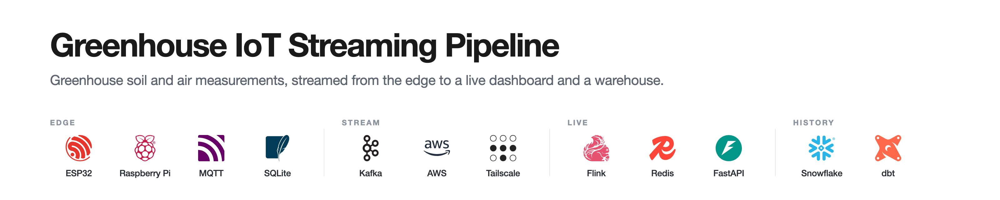
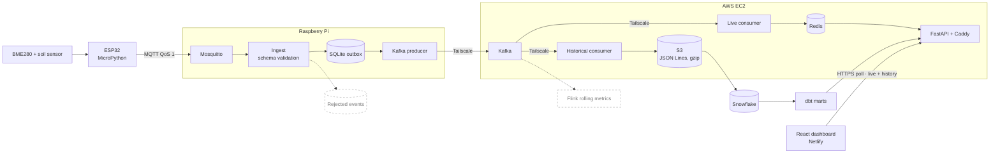

<p align="center">
  
</p>

<p align="center">
  
  
  
  
  
  
  
  
  
  
  
  
  
  
  
</p>

# Greenhouse IoT Streaming Pipeline

An end-to-end streaming pipeline for greenhouse temperature, humidity, atmospheric pressure, and soil moisture. Sensors on an ESP32 publish readings over MQTT to a Raspberry Pi, which validates and buffers them in SQLite before forwarding them to Kafka on AWS. A live consumer keeps the latest values in Redis for a React dashboard served by FastAPI. A historical consumer archives every event to S3; dbt models in Snowflake power a history API for analytics.

**Live:** [Dashboard](https://greenhouse.gregoryjoshua.com) · [API health](https://api.gregoryjoshua.com/health)


## Architecture



Solid boxes are implemented. Dashed boxes are on the [roadmap](#roadmap). Details: [Architecture](docs/architecture.md).

## Data flow

1. The ESP32 reads the sensors and publishes one JSON event per measurement over MQTT (QoS 1) to Mosquitto on the Pi.
2. The Pi validates each event against its schema version, commits it to SQLite, and only then acknowledges the MQTT message.
3. A producer sends pending rows to Kafka and marks a row delivered only after Kafka acknowledges it.
4. The live consumer updates the latest reading per sensor and measurement in Redis, committing its Kafka offset after the write.
5. The historical consumer, in its own consumer group, batches events into gzip-compressed JSON Lines objects in S3 (partitioned by date and named by Kafka offset range) and commits only after the upload succeeds.
6. The S3 archive is loaded into Snowflake. dbt builds staging, intermediate, and mart models (hourly and daily facts) with `event_id` deduplication.
7. FastAPI serves live readings from Redis and historical series from Snowflake marts (`GET /api/v1/history/series`). The React dashboard has a **Live** tab (polls every 3 seconds; readings older than 30 seconds are stale) and a **History** tab (trends, weighted summaries, and period insights from the history API).

Delivery is at-least-once, with deduplication by `event_id`.

## What this demonstrates

- **Durable edge buffering.** A SQLite outbox with acknowledge-after-commit ingestion keeps accepted events through Kafka and network outages. Retention cleanup removes only delivered rows.
- **Delivery semantics.** Persistent QoS 1 sessions, an acknowledged idempotent Kafka producer, manual offset commits, and idempotent Redis updates (a Lua script rejects older timestamps).
- **Versioned data contracts.** JSON Schema v1 and v2 coexist, and the gateway validates by `schema_version`.
- **Replayable streaming.** Kafka retains 7 days of events, and two independent consumer groups read the same topic: a live view and a durable archive.
- **Historical archive and warehouse.** Every event lands in S3 as date-partitioned, offset-ranged `.jsonl.gz` objects. dbt models in [`warehouse/`](warehouse/) turn the Snowflake raw table into hourly and daily marts; FastAPI exposes them on `/api/v1/history/series` with JWT key auth, and the dashboard History tab charts those series.
- **Operations.** systemd services and timers, Docker Compose, a gateway health check with exit codes, and deployment verification scripts.
- **Testing and CI/CD.** pytest suites for schemas, ingest, cleanup, health, the live consumer (offset-commit ordering, Redis timestamp guard), and the API against a real Redis. GitHub Actions runs them with a dashboard lint, unit tests, and build, then deploys to the Pi and EC2 over Tailscale and SSH on `main`.
- **Decision records.** The reasoning behind the main design choices is written down as [ADRs](docs/decisions/README.md).
- **Networking and security basics.** Tailscale between hosts, authenticated MQTT, loopback-bound API behind Caddy HTTPS, and secrets kept out of Git.
- **Embedded work.** MicroPython firmware with shared I²C sensors, NTP time sync, per-sensor failure isolation with automatic recovery, and non-blocking network retry.

## Roadmap

Planned work, grouped by theme. Items are not scheduled.

**Reliability and hardening**

- **Rejected-event storage.** Persist invalid payloads and validation errors in a dead-letter table with bounded retention and a replay path, and quarantine malformed Kafka messages in the historical consumer instead of stopping on them.
- **Gateway input hardening.** Handle non-object JSON and malformed `schema_version` values without a process restart, and enforce `uuid` and `date-time` formats at the gateway so it agrees with the consumer's checks.
- **Firmware.** Socket timeouts so a stalled broker cannot block publishing, a periodic heartbeat with firmware version, optional on-device buffering, and calibrated soil moisture as a new unit.
- **Kafka.** A multi-broker cluster with replication for high availability and storage-loss protection, and a topic-level retention policy managed as code.
- **Transport security.** TLS for MQTT and Kafka, and per-device MQTT accounts with topic ACLs.
- **Redis recovery.** An automated, tested rebuild from Kafka, and expiry for retired sensors.

**Observability**

- **External alerting** for outages and a growing backlog.
- **Downstream health checks** for Kafka, the consumer, Redis, the API, and the ESP32, plus consumer-lag metrics and an end-to-end synthetic probe.
- **Centralized, structured logging.**

**CI/CD and infrastructure**

- **Deploy verification and rollback.** Run `verify-deployment.sh` and a data-freshness check after each deploy, and roll back automatically on failure. Deploy tagged container images from a registry.
- **Safer triggers.** Path filters so documentation-only changes do not redeploy, and environment approvals for production.
- **Broader deployment.** Pi systemd units, a migration runner for the SQLite database, Kafka host and Caddy configuration, and firmware releases.
- **Terraform.** EC2 instances, security groups, DNS, and host bootstrap as code.
- **Configuration as code.** Commit Netlify build settings (and any remaining site config) to the repository alongside `VITE_API_URL`.

**Analytics and features**

- **History metadata endpoint.** Expose warehouse-known sensors and measurement types so History can list devices that are offline or missing from Redis.
- **Richer history UX.** Multi-metric comparison on one chart, and quality overlays from daily quality marts.
- **Warehouse automation.** Schedule or further automate the S3 → Snowflake load and `dbt run` (profiles and orchestration live outside the API containers).
- **Flink.** Event-time rolling-window metrics, such as 5-minute averages and moisture trends.
- **More sensors.** Additional measurement types (for example light or CO₂) through new schema versions.

## Documentation

| Document | Contents |
| --- | --- |
| [Architecture](docs/architecture.md) | Components, event flow, data stores, delivery guarantees |
| [Data contracts](docs/data-contracts.md) | Schemas, validation points, safe schema evolution |
| [Adding a sensor](docs/adding-a-sensor.md) | Step-by-step guide and checklist |
| [Deployment](docs/deployment.md) | CI/CD, setup, updates, verification, and rollback for each component |
| [Operations](docs/operations.md) | Health checks, logs, troubleshooting |
| [Decision records](docs/decisions/README.md) | ADRs for the main design choices |
| [ESP32 firmware](firmware/esp32/README.md) | Hardware, MicroPython flashing, wiring, configuration |
| [Infrastructure](infrastructure/README.md) | Component-level infrastructure notes |
| [Warehouse (dbt)](warehouse/) | Staging, intermediate, and mart models over Snowflake |

Configuration templates: [`.env.example`](.env.example), [`firmware/esp32/config.example.py`](firmware/esp32/config.example.py). Schemas: [`schemas/`](schemas/).

## Repository layout

```text
firmware/esp32/      MicroPython sensor firmware
sensor_simulator/    Synthetic MQTT event generator
gateway/             Raspberry Pi ingest, producer, cleanup, health, migrations
schemas/             Versioned event schemas and examples
consumers/live/      Kafka to Redis consumer
consumers/historical/ Kafka to S3 archive consumer
api/                 FastAPI service (live Redis + Snowflake history)
warehouse/           dbt project (staging, intermediate, marts)
dashboard/           React / Vite dashboard (Live + History tabs)
infrastructure/      systemd, Mosquitto, Kafka, Caddy config and scripts
tests/               pytest suites (schemas, gateway, consumer, API)
.github/workflows/   CI and deployment workflow
requirements/        Dependencies per deployment role
compose.yaml         Consumers, Redis, and API containers
docs/                Architecture, contracts, deployment, operations
```
