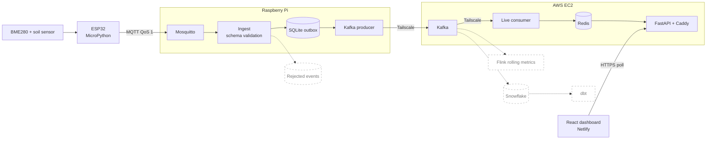

<p align="center">
  
</p>

<p align="center">
  
  
  
  
  
  
  
  
  
  
  
  
  
  
  
</p>

# Greenhouse IoT Streaming Pipeline

An end-to-end streaming pipeline for greenhouse temperature, humidity, atmospheric pressure, and soil moisture. Sensors on an ESP32 publish readings over MQTT to a Raspberry Pi, which validates and buffers them in SQLite before forwarding them to Kafka on AWS. A consumer keeps the latest values in Redis, and FastAPI serves them to a live React dashboard.

The project exists to practice building a reliable data path across constrained edge hardware, an unreliable network, and cloud services: durable buffering, explicit acknowledgments, versioned data contracts, and operational tooling, rather than a demo that only works when nothing fails.

**Live:** [Dashboard](https://greenhouse.gregoryjoshua.com) · [API health](https://api.gregoryjoshua.com/health)


## Architecture



Solid boxes are implemented. Dashed boxes are planned. Details: [Architecture](docs/architecture.md).

## Data flow

1. The ESP32 reads the sensors and publishes one JSON event per measurement over MQTT (QoS 1) to Mosquitto on the Pi.
2. The Pi validates each event against its schema version, commits it to SQLite, and only then acknowledges the MQTT message.
3. A producer sends pending rows to Kafka and marks a row delivered only after Kafka acknowledges it.
4. The live consumer updates the latest reading per sensor and measurement in Redis, committing its Kafka offset after the write.
5. FastAPI reads Redis, and the dashboard polls it every 3 seconds, flagging readings older than 30 seconds as stale.

Delivery is at-least-once, with deduplication by `event_id`.

## What this demonstrates

- **Durable edge buffering.** A SQLite outbox with acknowledge-after-commit ingestion keeps accepted events through Kafka and network outages. Retention cleanup removes only delivered rows.
- **Delivery semantics.** Persistent QoS 1 sessions, an acknowledged idempotent Kafka producer, manual offset commits, and idempotent Redis updates (a Lua script rejects older timestamps). No exactly-once claim is made.
- **Versioned data contracts.** JSON Schema v1 and v2 coexist, and the gateway validates by `schema_version`.
- **Replayable streaming.** Kafka retains 7 days of events, so other consumer groups can be added.
- **Operations.** systemd services and timers, Docker Compose, a gateway health check with exit codes, and deployment verification scripts.
- **Networking and security basics.** Tailscale between hosts, authenticated MQTT, loopback-bound API behind Caddy HTTPS, and secrets kept out of Git.
- **Embedded work.** MicroPython firmware with shared I²C sensors, NTP time sync, and retry logic.

## Roadmap

Planned work. None of it exists yet.

- **Rejected-event storage.** Persist invalid payloads and validation errors with bounded retention. Today they are logged and dropped.
- **Historical analytics.** A separate Kafka consumer group loading Snowflake, with dbt models and historical dashboard views.
- **Flink.** Event-time rolling-window metrics, such as 5-minute averages and moisture trends.
- **Firmware reliability.** Verified unattended boot, disconnected-sensor recovery, bounded network timeouts, and optional on-device buffering.
- **Testing and monitoring.** Wider automated coverage (ingest, schemas, producer, consumer, API), a tested Redis rebuild procedure, and external alerting.
- **CI/CD.** GitHub Actions already runs automated tests on every push and pull request. Everything after that is manual: deploying means pulling the latest Git changes on the Raspberry Pi or EC2 hosts and restarting services or containers. The goal is to reduce manual deployments by extending CI/CD beyond testing: automated build and validation, then deployment to the Pi and EC2 services with safeguards (tests as a gate, post-deploy checks) and a defined rollback. The design is not decided, and automated production deployment does not exist today.

## Current limitations

- ESP32 readings can be lost on a reset or while the Pi is unreachable. Durability starts when the Pi commits an event to SQLite.
- Delivery is at-least-once; duplicates are possible after failures.
- Kafka is a single broker with replication factor 1, with no high availability.
- MQTT is authenticated but not encrypted (port 1883). Kafka clients use `PLAINTEXT` inside the Tailscale network.
- Soil moisture is raw capacitance, not a calibrated percentage.
- Test coverage is limited to gateway cleanup and health. Deployment is manual.

## Documentation

| Document | Contents |
| --- | --- |
| [Architecture](docs/architecture.md) | Components, event flow, data stores, delivery guarantees |
| [Data contracts](docs/data-contracts.md) | Schemas, validation points, safe schema evolution |
| [Adding a sensor](docs/adding-a-sensor.md) | Step-by-step guide and checklist |
| [Deployment](docs/deployment.md) | Setup, updates, verification, and rollback for each component |
| [Operations](docs/operations.md) | Health checks, logs, troubleshooting |
| [Decision records](docs/decisions/README.md) | Placeholder for future ADRs |
| [ESP32 firmware](firmware/esp32/README.md) | Hardware, MicroPython flashing, wiring, configuration |
| [Infrastructure](infrastructure/README.md) | Component-level infrastructure notes |

Configuration templates: [`.env.example`](.env.example), [`firmware/esp32/config.example.py`](firmware/esp32/config.example.py). Schemas: [`schemas/`](schemas/).

## Repository layout

```text
firmware/esp32/      MicroPython sensor firmware
sensor_simulator/    Synthetic MQTT event generator (needs a fix)
gateway/             Raspberry Pi ingest, producer, cleanup, health, migrations
schemas/             Versioned event schemas and examples
consumers/live/      Kafka to Redis consumer
api/                 FastAPI service
dashboard/           React / Vite dashboard
infrastructure/      systemd, Mosquitto, Kafka, Caddy config and scripts
tests/gateway/       pytest tests
requirements/        Dependencies per deployment role
compose.yaml         Consumer, Redis, and API containers
docs/                Architecture, contracts, deployment, operations
```
