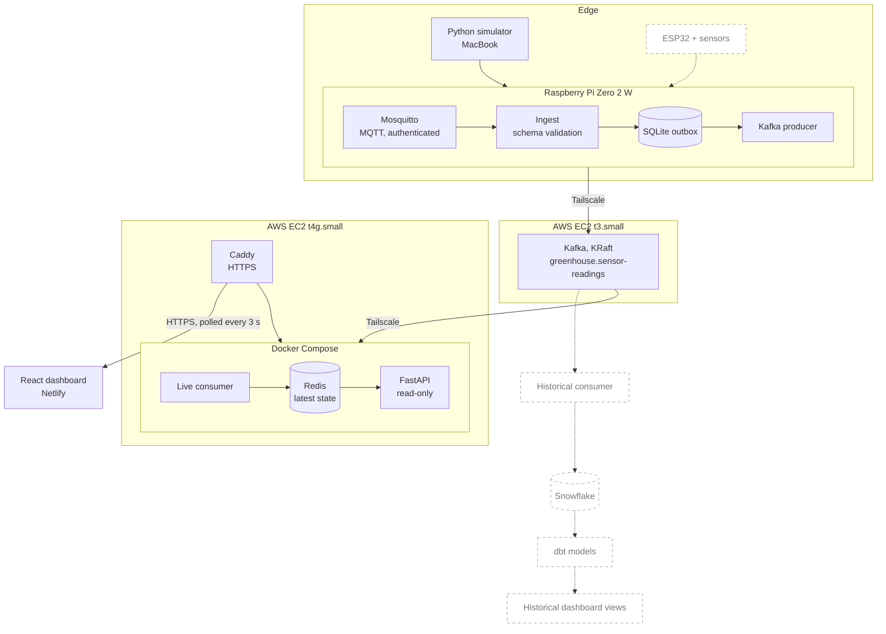

<p align="center">
  
</p>

<p align="center">
  
  
  
  
  
  
  
  
  
  
  
  
  
  
  <br>
  
  
  
</p>

# Greenhouse IoT Streaming Pipeline

An end-to-end streaming pipeline for greenhouse soil and air measurements. Events travel from MQTT through a durable Raspberry Pi outbox into Kafka on AWS. A consumer materializes the latest readings in Redis, FastAPI serves them, and a React dashboard displays them. A Snowflake and dbt branch for historical analytics is planned.

**Status:** the live path runs end to end on simulated data. Physical sensors and a historical analytics consumer are planned.

**Live:** [Dashboard](https://greenhouse.gregoryjoshua.com) · [API health](https://api.gregoryjoshua.com/health). Readings show as *Stale* when the simulator is not running.

## Architecture



Dashed nodes and edges are planned.

**Live path (implemented).** The Pi validates each event, stores it in SQLite, and publishes it to Kafka on an EC2 instance. A consumer on a second EC2 instance keeps the newest reading per sensor and metric in Redis. FastAPI reads only Redis, and the dashboard polls it every 3 seconds through Caddy.

**Historical path (planned).** A separate consumer group will load the same topic into Snowflake, and dbt will model it for historical views in the dashboard. Kafka's 7-day retention lets this consumer be added without changing the live path.

## Key engineering features

### Ingestion and delivery

- **Schema-validated events.** Events follow a versioned JSON Schema that rejects unknown fields. The simulator validates before publishing and the gateway validates again on ingest, so malformed data never enters the outbox. Invalid events are logged and dropped.
- **Durable edge buffering.** [`ingest.py`](gateway/ingest.py) uses a persistent MQTT QoS 1 session with manual acknowledgment. It commits each event to SQLite (`synchronous=FULL`) before acknowledging, so a Kafka or network outage does not stop ingestion. Pending events stay on the Pi until Kafka confirms them.
- **Outbox publisher.** [`kafka_producer.py`](gateway/kafka_producer.py) sends the oldest pending events in batches of 100 with `acks=all` and an idempotent producer. It marks an event published only after Kafka acknowledges it, starts no new batch while one is in flight, and waits for in-flight deliveries on shutdown. This keeps memory bounded on the Pi.
- **At-least-once delivery with deduplication.** Every event has a unique `event_id`, which is the outbox primary key and the Kafka message key. The idempotent producer suppresses its own retry duplicates. Others are possible, for example after a crash between Kafka's acknowledgment and the SQLite update, so consumers deduplicate on `event_id`.

| Hop | Mechanism | Guarantee |
| --- | --- | --- |
| Simulator to Mosquitto | MQTT QoS 1 | At-least-once |
| Mosquitto to SQLite | Persistent QoS 1 session, acknowledged after the commit | At-least-once. Repeats are dropped by primary key |
| SQLite to Kafka | `acks=all`, idempotent producer | At-least-once |
| Kafka to Redis | Offset committed after the Redis write | At-least-once with idempotent state |

- **Decoupled, replayable consumers.** Kafka retains data for 7 days and each consumer group tracks its own offsets. A new group can replay from the earliest offset, and a historical consumer can be added without touching the live path. A tested Redis rebuild procedure is [TBD].

### Serving

- **Timestamp-safe latest state.** The consumer updates Redis with an atomic Lua script that ignores readings older than the stored one, so replays and out-of-order events cannot overwrite newer data. It commits the Kafka offset only after the Redis write.
- **Read-only API on a derived view.** [`api/main.py`](api/main.py) reads only Redis, never Kafka. It uses `SCAN` with pipelined reads rather than `KEYS`, its `/health` endpoint checks Redis connectivity, and CORS allows only `GET` from configured origins.
- **Freshness-aware dashboard.** The dashboard polls every 3 seconds, marks readings older than 30 seconds as stale, and keeps the last known values visible if the API is unreachable.

### Operations

- **Retention.** [`cleanup.py`](gateway/cleanup.py) runs hourly and deletes acknowledged events older than 24 hours in bounded batches, never pending ones, and supports `--dry-run`. Partial indexes on pending and published rows support these queries. The index migration is applied manually and there is no migration runner.
- **Health monitoring.** [`health.py`](gateway/health.py) runs every minute against a read-only SQLite connection. It prints JSON with backlog size and age, ingestion and delivery freshness, database size, and disk use. Thresholds are configurable, and the exit code is 0, 1, or 2 for healthy, warning, or critical.
- **Configuration as code.** [`infrastructure/`](infrastructure/) holds the systemd units and timers, Kafka KRaft, Mosquitto, and Caddy configuration, and two scripts. One validates unit files with `systemd-analyze verify` before installing. The other, `verify-deployment.sh`, makes read-only checks of services, containers, the Kafka topic, and the public endpoint.
- **Containerized backend.** Docker Compose runs the consumer, Redis with AOF persistence, and the API. Images run as a non-root user with pinned dependencies, Redis health gates startup, and containers restart automatically. Redis is not published, and the API binds to loopback behind Caddy's HTTPS.
- **Private networking and secrets.** The Kafka client listener binds to the broker's Tailscale address, MQTT requires authentication, and credentials live in a git-ignored `.env` and a password file outside the repo.
- **Testing and CI.** 16 [pytest](tests/gateway) tests cover cleanup and health logic, and [GitHub Actions](.github/workflows/tests.yml) runs them on every push and pull request. Ingest, the producer, the consumer, and the API have no automated tests yet. [TBD]

### Known limitations

- Delivery is not exactly-once end to end.
- Kafka is a single node with replication factor 1. It is not highly available and does not protect against broker storage loss.
- Invalid MQTT events are dropped, not quarantined. Dead-letter handling is planned.
- The Kafka producer and consumer use `PLAINTEXT` over Tailscale. MQTT on port 1883 is authenticated but not TLS-encrypted.
- There is no external outage alerting.

## Data contract

Every message is one measurement, defined by the versioned JSON Schema [`schemas/sensor_event.schema.json`](schemas/sensor_event.schema.json). All fields are required, extra fields are rejected, and `schema_version` is currently `1`.

| `measurement_type` | `unit` |
| --- | --- |
| `soil_moisture` | `raw_capacitance` |
| `soil_temperature` | `celsius` |
| `air_temperature` | `celsius` |
| `relative_humidity` | `percent` |


An example event:
```json
{
  "schema_version": 1,
  "event_id": "550e8400-e29b-41d4-a716-446655440000",
  "sensor_id": "soil-001",
  "gateway_id": "pi-001",
  "timestamp": "2026-10-20T19:30:00Z",
  "measurement_type": "soil_moisture",
  "value": 475,
  "unit": "raw_capacitance"
}
```

## Getting started

A full deployment spans a Raspberry Pi, two EC2 instances, and Netlify, so it cannot be started with one command. [`infrastructure/README.md`](infrastructure/README.md) covers deployment, networking, and operations, and will cover a full reproducibility guide in the near future.

## Repository structure

```text
.
├── gateway/                        Raspberry Pi services
│   ├── ingest.py                   MQTT to SQLite outbox
│   ├── kafka_producer.py           SQLite outbox to Kafka
│   ├── cleanup.py                  Retention job
│   ├── health.py                   Health check
│   └── migrations/                 SQL migrations
├── sensor_simulator/simulate.py    Synthetic event generator
├── consumers/live/                 Kafka to Redis consumer, dockerfile
├── api/                            FastAPI app, dockerfile
├── dashboard/                      React and Vite app
├── schemas/                        Event schema and example
├── infrastructure/                 Caddy, Kafka, Mosquitto, systemd, scripts, README
├── tests/gateway/                  pytest tests
├── .github/workflows/tests.yml     CI
├── requirements/                   Python dependencies per role
├── compose.yaml                    Redis, consumer, API
├── .env.example
└── assets/                         README images
```
