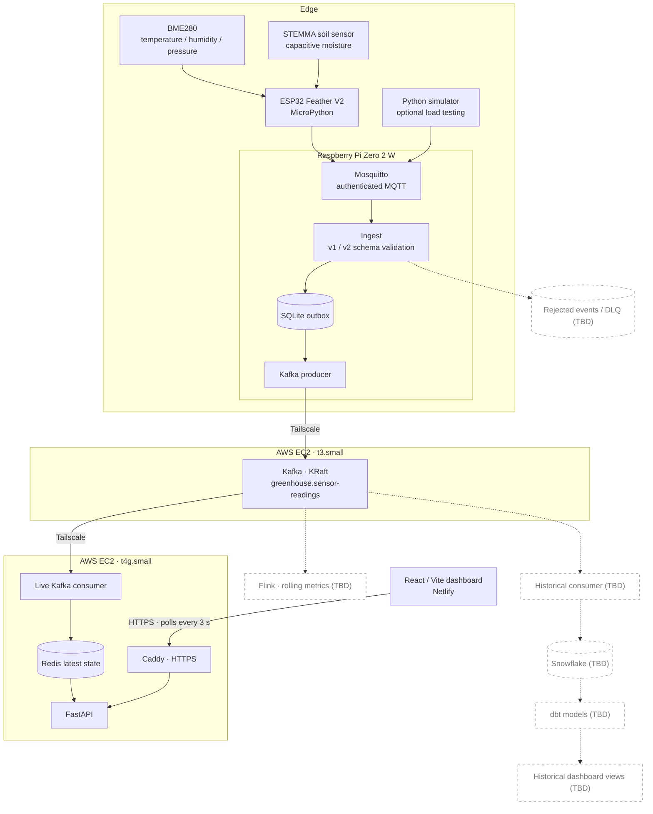

<p align="center">
  
</p>

<p align="center">
  
  
  
  
  
  
  
  
  
  
  
  
  
  
  
</p>

# Greenhouse IoT Streaming Pipeline

An end-to-end streaming pipeline for greenhouse temperature, humidity, atmospheric pressure, and soil moisture. Physical sensors connect to an ESP32, which publishes readings over MQTT to a Raspberry Pi. The Pi validates and buffers events in SQLite before sending them to Kafka on AWS. A separate consumer maintains the latest readings in Redis, which FastAPI serves to a live React dashboard.

**Status:** The live MQTT → SQLite → Kafka → Redis → FastAPI → React path is implemented. The BME280 and capacitive soil sensor have been connected to the ESP32 and tested with MicroPython. Schema v2 adds atmospheric pressure and supports readings from both physical sensors. Standalone ESP32 boot/publishing reliability and full v2 downstream verification are still being tested. Historical analytics, rolling-window stream processing, and rejected-event storage are planned.

**Live:** [Dashboard](https://greenhouse.gregoryjoshua.com) · [API health](https://api.gregoryjoshua.com/health)

## Architecture



Solid paths represent implemented components; dashed paths represent planned work. The live path was built with simulated readings first, then extended to physical sensors. The simulator remains useful for load tests.

## Physical sensors and firmware

An **Adafruit ESP32 Feather V2** runs MicroPython and reads two sensors over a shared STEMMA QT I²C bus:

| Sensor | I²C address | Measurement types | Units |
| --- | --- | --- | --- |
| BME280 | `0x77` | `air_temperature`, `relative_humidity`, `atmospheric_pressure` | `celsius`, `percent`, `hpa` |
| Adafruit STEMMA Soil Sensor | `0x36` | `soil_moisture` | `raw_capacitance` |

The firmware enables STEMMA QT power, reads both sensors, synchronizes UTC time with NTP, and publishes **one JSON event per measurement** using MQTT QoS 1. Sampling is configurable; at a 5-second interval, the two sensors produce four events per cycle (48/minute). `main.py` handles network and publishing logic, while `sensors.py` handles sensor-specific initialization and readings.

The ESP32 stores Wi-Fi and MQTT configuration locally in a git-ignored `config.py`. It retries connections and pending publishes, but pending events are **RAM-only**, so device resets or extended outages can lose readings. Automatic operation after moving to an independent power supply is still being tested.

See [`firmware/esp32/README.md`](firmware/esp32/README.md) for hardware wiring, MicroPython flashing, configuration, and deployment instructions.

## Data contract

Each MQTT message represents a single measurement with a unique event ID and a UTC timestamp. The project maintains **schema v1 and v2** so the existing simulator and newer ESP32 firmware can coexist. All required fields are validated, and unknown fields are rejected.

| Version | Measurements |
| --- | --- |
| v1 | `air_temperature`, `relative_humidity`, `soil_moisture`, `soil_temperature` |
| v2 | All v1 measurements, plus `atmospheric_pressure` (`hpa`) |

Schema files: [`schemas/`](schemas/). The gateway selects the validation schema using `schema_version`.

Example schema v2 event:

```json
{
  "schema_version": 2,
  "event_id": "550e8400-e29b-41d4-a716-446655440003",
  "sensor_id": "bme280-001",
  "gateway_id": "pi-001",
  "timestamp": "2026-10-27T07:30:00Z",
  "measurement_type": "atmospheric_pressure",
  "value": 1013.2,
  "unit": "hpa"
}
```

For soil moisture, `value` remains **raw capacitance**, not a calibrated percentage. Pressure is included in v2 without changing the eight-field event structure.

## Key engineering features

### Ingestion and delivery

- **Validated ingestion.** The Raspberry Pi ingestor subscribes to `greenhouse/telemetry`, checks the event against its declared schema version, and writes accepted events to a SQLite outbox. Invalid events are currently logged and dropped; storing them for inspection is [TBD].
- **Durable edge outbox.** The MQTT ingestor uses a persistent QoS 1 session with manual acknowledgment and commits accepted events to SQLite (`synchronous=FULL`) before acknowledging. A Kafka outage does not require stopping sensor ingestion; accepted events remain pending on the Pi.
- **Reliable Kafka producer.** The producer sends oldest pending events in bounded batches (100 by default), uses `acks=all` and idempotence, and marks events published only after Kafka acknowledgment. In-flight deliveries are handled during shutdown.
- **At-least-once processing.** `event_id` is the SQLite outbox primary key and Kafka message key. Duplicates are still possible across failures and retries; downstream processing is designed to handle them. The pipeline does not claim end-to-end exactly-once delivery.
- **Independent Kafka consumers.** The live consumer maintains its own offsets. Kafka retention is configured for 7 days, allowing other consumer groups to be added and retained data to be replayed within that window.

| Hop | Delivery behavior |
| --- | --- |
| ESP32 → Mosquitto | MQTT QoS 1; retries in firmware, no durable ESP32 queue |
| Mosquitto → SQLite | Persistent QoS 1 session; acknowledge after database commit |
| SQLite → Kafka | Acknowledged, idempotent producer; pending rows retried |
| Kafka → Redis | Commit Kafka offset after Redis update; idempotent latest-state logic |

### Live serving

- **Latest reading per metric.** The Kafka consumer stores the latest reading under `greenhouse:latest:{gateway_id}:{sensor_id}:{measurement_type}`. A Lua script rejects older timestamps so late or replayed events cannot overwrite newer state.
- **Redis-backed API.** FastAPI reads Redis rather than Kafka. The API uses `SCAN` and pipelined reads; `/health` checks Redis connectivity. Caddy terminates HTTPS in front of the loopback-bound API.
- **Live dashboard.** React/Vite is deployed on Netlify. It polls the API every 3 seconds, marks readings older than 30 seconds as stale, and retains the last known values if the API is unavailable.

### Operations and testing

- **SQLite retention.** `gateway/cleanup.py` runs hourly, removing acknowledged events older than 24 hours in bounded batches. Pending events are never deleted because of age. A dry-run mode is available.
- **Gateway health checks.** `gateway/health.py` reports backlog count and age, ingestion/delivery freshness, database size, and disk usage as JSON with healthy/warning/critical exit codes.
- **Deployment configuration.** `infrastructure/` contains systemd services and timers, Mosquitto, Kafka KRaft, Caddy configuration, and deployment verification scripts.
- **Containerized serving stack.** Docker Compose runs the Kafka consumer, Redis with AOF persistence, and FastAPI. Redis is not publicly exposed; Caddy provides HTTPS for the API.
- **Networking and secrets.** Tailscale connects the Pi to Kafka and the serving stack. MQTT requires authentication. Host credentials are kept outside Git; ESP32 Wi-Fi/MQTT credentials are stored in git-ignored `firmware/esp32/config.py`.
- **CI.** GitHub Actions runs pytest tests for gateway cleanup and health monitoring. Broader tests covering ingestion, schema compatibility, the producer, live consumer, and API are [TBD].

## Planned work

- **Rejected-event storage.** Persist invalid MQTT payloads and validation errors in a separate SQLite table or dead-letter mechanism, with bounded retention. Currently invalid events are logged and dropped.
- **Historical analytics.** Add a separate Kafka consumer group to load events into Snowflake, transform them with dbt, and expose historical metrics and charts. [TBD]
- **Flink stream processing.** Compute event-time rolling metrics such as 5-minute average temperature/humidity and short-window moisture trends for the live dashboard. [TBD]
- **Firmware reliability.** Verify unattended boot from external USB power, improve disconnected-sensor recovery, add bounded network timeouts and optional persistent buffering on the ESP32. [TBD]
- **End-to-end tests and monitoring.** Expand automated coverage, test Redis rebuild/replay procedures, and add external outage alerting. [TBD]

## Known limitations

- ESP32 readings can be lost during a device reset or before an MQTT publish is acknowledged; SQLite buffering begins only after the Raspberry Pi receives and accepts an event.
- Delivery is at-least-once, not exactly-once end to end.
- Kafka runs on one EC2 broker with replication factor 1; the broker is not highly available.
- The Kafka clients use `PLAINTEXT` inside the Tailscale network. MQTT port 1883 is authenticated but not TLS-encrypted.
- Invalid events are not yet retained in a separate database/table.
- The historical warehouse and Flink rolling metrics are not implemented.

## Getting started

This deployment spans an ESP32, Raspberry Pi, two EC2 instances, and Netlify; there is no single-command local deployment.

- **ESP32 hardware and firmware:** [`firmware/esp32/README.md`](firmware/esp32/README.md)
- **Infrastructure, services, and operations:** [`infrastructure/README.md`](infrastructure/README.md)
- **Simulator:** [`sensor_simulator/simulate.py`](sensor_simulator/simulate.py), useful for synthetic traffic and load tests
- **Configuration:** [`.env.example`](.env.example) for host services and `firmware/esp32/config.example.py` for the device

To inspect events arriving on the Pi:

```bash
mosquitto_sub -h localhost -t greenhouse/telemetry -u YOUR_MQTT_USERNAME -P 'YOUR_MQTT_PASSWORD' -v
```

To check the SQLite outbox:

```bash
sqlite3 -header -column gateway/data/sensor_events.db \
  "SELECT timestamp, sensor_id, measurement_type, value, unit FROM sensor_events ORDER BY timestamp DESC LIMIT 12;"
```

## Repository structure

```text
.
├── firmware/esp32/                 MicroPython sensor firmware and setup
├── sensor_simulator/               Synthetic MQTT event generator
├── gateway/                        Raspberry Pi ingest, outbox, producer, cleanup, health
│   └── migrations/                 SQLite migrations
├── schemas/                        Versioned event schemas and examples
├── consumers/live/                 Kafka → Redis consumer
├── api/                            FastAPI service
├── dashboard/                      React / Vite dashboard
├── infrastructure/                 Deployment config, scripts, documentation
├── tests/gateway/                  pytest tests
├── .github/workflows/              CI
├── requirements/                   Dependencies per deployment role
├── compose.yaml                    Consumer, Redis, FastAPI
├── .env.example                    Host configuration template
└── assets/                          README images and badges
```
