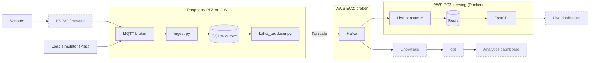

<p align="center">
  
</p>

<p align="center">
  
  
  
  
  
  
  
  
  
  
  
  
  
</p>

# Greenhouse IoT Streaming Pipeline

A streaming pipeline for greenhouse soil and air measurements. Readings are published over MQTT to a Raspberry Pi gateway, buffered in SQLite, and forwarded to Kafka on AWS. From Kafka, a live path keeps the latest reading per sensor in Redis behind a FastAPI app, and an analytics path will build a queryable history in Snowflake.

**Status:** in progress. The path from MQTT to Kafka to the API works. The ESP32 firmware, dashboards, and Snowflake path are **[TBD]**.

## Architecture



Dashed nodes are [TBD].

| Component | Role | Status |
| --- | --- | --- |
| Sensors and ESP32 | Read soil and air values and publish them to MQTT | [TBD] |
| Load simulator | Publishes synthetic events at volumes above the physical sensors | Working |
| MQTT broker | Entry point on the Pi | Working |
| Gateway ingest | Validates events and writes them to the SQLite outbox. Runs as a `systemd` service | Working |
| Kafka producer | Drains the outbox to Kafka. Runs as a `systemd` service | Working |
| Kafka | Durable log shared by both paths. Runs as a `systemd` service on EC2 | Working |
| Live consumer | Reads Kafka and maintains the latest readings in Redis. Docker, on a second EC2 instance | Working |
| Redis | Latest reading per sensor and metric. Docker, same instance | Working |
| FastAPI | Read-only HTTP API over Redis. Docker, same instance | Working |
| HTTPS reverse proxy | Public entry point in front of the API | [TBD] |
| Live dashboard | Browser UI over the API | [TBD] |
| Flink | Stream processing beyond the latest-reading view | [TBD] |
| Snowflake, dbt, analytics dashboard | History and models | [TBD] |

## Sensor event

Every message is one measurement, defined by [`schemas/sensor_event.schema.json`](schemas/sensor_event.schema.json). See [`schemas/sensor_event.example.json`](schemas/sensor_event.example.json).

| Field | Type | Meaning |
| --- | --- | --- |
| `schema_version` | integer | Always `1` |
| `event_id` | UUID | Unique id, used for deduplication |
| `sensor_id` | string | Sensor that took the reading |
| `gateway_id` | string | Gateway that published it |
| `timestamp` | date-time | UTC time of the measurement |
| `measurement_type` | enum | See below |
| `value` | number | The reading |
| `unit` | enum | Unit of `value` |

All fields are required and extra fields are rejected.

| `measurement_type` | `unit` |
| --- | --- |
| `soil_moisture` | `raw_capacitance` |
| `soil_temperature` | `celsius` |
| `air_temperature` | `celsius` |
| `relative_humidity` | `percent` |

Soil moisture stays in raw capacitance and is not converted to a percentage.

```json
{
  "schema_version": 1,
  "event_id": "550e8400-e29b-41d4-a716-446655440000",
  "sensor_id": "soil-001",
  "gateway_id": "pi-001",
  "timestamp": "2026-10-20T19:30:00Z",
  "measurement_type": "soil_moisture",
  "value": 475,
  "unit": "raw_capacitance"
}
```

## Setup

Each role has its own dependencies in [`requirements/`](requirements/) and runs on its own machine. All roles read one `.env` file at the repo root. Copy `.env.example` to `.env` first.

### Load simulator (macOS)

Requires Python 3.11+.

[`sensor_simulator/simulate.py`](sensor_simulator/simulate.py) publishes schema-valid synthetic events to the Pi's MQTT broker. It exists to exercise the pipeline at volumes the physical sensors cannot produce, so throughput and backpressure can be tested before the full sensor set is installed.

It currently emits soil moisture, air temperature, and relative humidity at about three events per second. A configurable rate and `soil_temperature` are [TBD].

```bash
python3 -m venv .venv
source .venv/bin/activate
pip install -r requirements/simulator.txt
python3 sensor_simulator/simulate.py
```

### Gateway (Raspberry Pi)

Requires Raspberry Pi OS, Python 3.11+, and a Mosquitto broker on port 1883.

```bash
python3 -m venv .venv
source .venv/bin/activate
pip install -r requirements/gateway.txt
```

`ingest.py` and `kafka_producer.py` are independent processes. On the Pi, each runs as a `systemd` service. The unit files are not in the repo yet. [TBD]

To run either by hand:

```bash
python3 gateway/ingest.py          # MQTT -> SQLite
python3 gateway/kafka_producer.py  # SQLite -> Kafka
```

### Serving stack (second EC2 instance)

Requires Docker with Compose. [`compose.yaml`](compose.yaml) runs the live consumer, Redis, and the API as three containers. Only `KAFKA_BOOTSTRAP_SERVERS` is required.

```bash
docker compose up -d --build
curl http://127.0.0.1:8000/health
curl http://127.0.0.1:8000/api/v1/sensors/latest
```

Containers restart automatically (`unless-stopped`). Redis data persists in a Docker volume.

### Configuration

| Variable | Used by | Notes |
| --- | --- | --- |
| `MQTT_HOST`, `MQTT_PORT` | Simulator | Address of the Pi's broker. Port is `1883` |
| `MQTT_USERNAME`, `MQTT_PASSWORD` | Simulator, ingest | Broker credentials |
| `MQTT_TOPIC` | Simulator | Use `greenhouse/telemetry`, which is what the gateway subscribes to |
| `KAFKA_BOOTSTRAP_SERVERS` | Producer, consumer | Broker address as reachable from that machine |
| `KAFKA_TOPIC` | Producer, consumer | Use `greenhouse.sensor-readings` |
| `KAFKA_BATCH_SIZE` | Producer | Events per batch. Use `100` |
| `KAFKA_RETRY_SECONDS` | Producer | Wait after a failed batch. Use `5` |
| `KAFKA_CONSUMER_GROUP` | Consumer | Defaults to `greenhouse-live-dev` |
| `CORS_ORIGINS` | API | Comma-separated browser origins. Defaults to `http://localhost:5173` |

Fill in every value the gateway uses. It reads a blank value as empty, not as the default. Docker Compose does fall back to the defaults above for a blank topic, consumer group, or CORS setting.

## Gateway

The Pi accepts readings whether or not the cloud is reachable.

- **Ingest.** [`ingest.py`](gateway/ingest.py) subscribes to `greenhouse/telemetry`, validates each event against the schema, and inserts it into a SQLite outbox keyed by `event_id`. Invalid events and duplicates are dropped.
- **Outbox.** SQLite decouples sensor ingestion from Kafka availability. If the broker or the link is down, events accumulate on disk and ingestion carries on.
- **Producer.** [`kafka_producer.py`](gateway/kafka_producer.py) selects events where `kafka_published_at IS NULL` in batches of 100, oldest first. Batching keeps memory on the Pi bounded, however large the backlog.
- **Acknowledgment.** An event is marked published only after Kafka confirms delivery (`acks=all`). Unconfirmed events stay pending and are retried.

### Delivery

Delivery is at-least-once. Producer idempotence suppresses duplicates caused by the Kafka client's own retries. A duplicate can still occur in other cases, for example a crash after Kafka acknowledges an event but before SQLite records it. `event_id` is unique per event, so downstream consumers deduplicate on it.

### Known limits

- **Disk is the limit during a long outage.** There are no capacity limits, disk monitoring, or full-storage policy yet. [TBD]
- **No outbox cleanup yet.** Planned: a script that deletes acknowledged records older than 24 hours. It will never delete unacknowledged records because of age. [TBD]

## Live serving

Kafka stays the source of truth. Redis holds a materialized view that can be rebuilt from the topic.

**Consumer.** [`consumers/live/consumer.py`](consumers/live/consumer.py) validates each event and writes it to a Redis hash keyed `greenhouse:latest:{gateway_id}:{sensor_id}:{measurement_type}`. A Lua script makes the update atomic and ignores any reading older than the one stored, so replays and out-of-order events cannot overwrite newer data. The Kafka offset is committed only after Redis confirms the write. Processing is at-least-once with idempotent updates.

Malformed events are logged, skipped, and committed so they do not block the stream. Quarantining them is [TBD]. A new consumer group replays from the earliest retained offset to rebuild Redis. Topic retention is [TBD].

**API.** [`api/main.py`](api/main.py) reads Redis only and never touches Kafka. It accepts `GET` requests and allows only the configured browser origins.

| Endpoint | Returns |
| --- | --- |
| `GET /health` | `{"status": "ok"}`, or `503` if Redis is unreachable |
| `GET /api/v1/sensors/latest` | `{"count": n, "readings": [...]}` with the latest reading per gateway, sensor, and metric |

Compose binds the API to `127.0.0.1:8000`. The HTTPS reverse proxy that will expose it is [TBD].

## Kafka and networking

Kafka runs as a `systemd` service on an EC2 instance. The Pi reaches it over a Tailscale tunnel, which encrypts the connection, so the producer uses `PLAINTEXT` and `KAFKA_BOOTSTRAP_SERVERS` is the broker's tailnet address.

The consumer, Redis, and API run on a second EC2 instance, separate from the broker. How that instance reaches Kafka is [TBD]. Topic partitions and retention are [TBD].

## Planned

- **Live dashboard** over the API.
- **Analytics path:** load Kafka into Snowflake, build dbt models, and add an analytics dashboard. The loading method is [TBD].
- **Flink** for stream processing beyond the latest-reading view.

## Repository layout

```text
.
├── gateway/                      Raspberry Pi services
│   ├── ingest.py                 MQTT -> SQLite outbox
│   ├── kafka_producer.py         SQLite outbox -> Kafka
│   └── data/                     SQLite database, created at runtime (git-ignored)
├── sensor_simulator/
│   └── simulate.py               Load simulator (Mac)
├── consumers/
│   └── live/
│       ├── consumer.py           Kafka -> Redis
│       └── dockerfile
├── api/
│   ├── main.py                   FastAPI app
│   └── dockerfile
├── requirements/                 One dependency file per role
│   ├── simulator.txt
│   ├── gateway.txt
│   ├── live.txt
│   └── api.txt
├── schemas/                      Shared event contract
│   ├── sensor_event.schema.json
│   └── sensor_event.example.json
├── compose.yaml                  Redis, live consumer, API
├── assets/                       README header and badges
├── .env.example                  Settings shared by all roles
└── README.md
```

<details>
<summary>Target layout [TBD]</summary>

A planned structure for the finished project. Names may change, and most of it does not exist yet.

```text
greenhouse-iot-streaming-pipeline/
│
├── README.md
├── pyproject.toml
├── .gitignore
├── .env.example
├── Makefile
│
├── firmware/                       # ESP32 sensor firmware
│   └── esp32/
│       ├── main.py
│       ├── config.example.py
│       └── README.md
│
├── simulator/                      # Synthetic IoT data generation
│   ├── simulate.py
│   └── load_test.py
│
├── gateway/                        # Raspberry Pi Zero 2 W
│   ├── ingest.py                   # MQTT → SQLite
│   ├── kafka_producer.py           # SQLite → Kafka
│   ├── storage.py                  # SQLite database operations
│   ├── cleanup.py                  # Retention / cleanup
│   └── migrations/
│       └── 001_initial.sql
│
├── consumers/
│   ├── dashboard/                  # Kafka consumer group A
│   │   ├── consumer.py             # Kafka → serving database
│   │   └── storage.py
│   │
│   └── warehouse/                  # Kafka consumer group B
│       ├── consumer.py             # Kafka → S3
│       └── writer.py               # Batching / object storage
│
├── stream_processing/
│   └── flink/
│       ├── jobs/
│       │   ├── latest_readings.py
│       │   └── anomaly_detection.py
│       └── README.md
│
├── api/
│   ├── main.py                     # FastAPI application
│   ├── routes/
│   │   ├── sensors.py
│   │   └── metrics.py
│   └── services/
│       └── readings.py
│
├── dashboard/
│   ├── app.py                      # Streamlit UI
│   ├── components/
│   │   ├── metric_cards.py
│   │   └── charts.py
│   └── pages/
│       └── historical.py
│
├── warehouse/
│   └── dbt/
│       ├── dbt_project.yml
│       ├── models/
│       │   ├── staging/
│       │   │   └── stg_sensor_events.sql
│       │   ├── intermediate/
│       │   └── marts/
│       │       ├── fct_sensor_readings.sql
│       │       └── agg_daily_conditions.sql
│       ├── macros/
│       └── tests/
│
├── schemas/
│   ├── sensor_event.schema.json
│   └── sensor_event.example.json
│
├── infrastructure/
│   ├── terraform/
│   │   ├── main.tf
│   │   ├── variables.tf
│   │   ├── outputs.tf
│   │   └── versions.tf
│   │
│   ├── docker/
│   │   ├── Dockerfile.consumer
│   │   ├── Dockerfile.api
│   │   └── Dockerfile.dashboard
│   │
│   ├── systemd/
│   │   ├── greenhouse-ingest.service
│   │   └── greenhouse-kafka-producer.service
│   │
│   └── docker-compose.yml
│
├── monitoring/
│   ├── metrics.py
│   ├── prometheus.yml
│   └── grafana/
│       └── dashboards/
│
├── tests/
│   ├── unit/
│   │   ├── test_schema.py
│   │   ├── test_ingest.py
│   │   └── test_kafka_producer.py
│   ├── integration/
│   │   ├── test_mqtt_to_sqlite.py
│   │   └── test_kafka_to_database.py
│   └── load/
│       └── README.md
│
├── scripts/
│   ├── setup_pi.sh
│   ├── verify_pipeline.py
│   └── benchmark.py
│
├── docs/
│   ├── architecture.md
│   ├── deployment.md
│   ├── data_contracts.md
│   ├── failure_recovery.md
│   ├── load_testing.md
│   └── decisions/
│       ├── 001-sqlite-buffer.md
│       └── 002-kafka-streaming.md
│
└── .github/
    └── workflows/
        ├── ci.yml
        └── docker-build.yml
```

</details>
