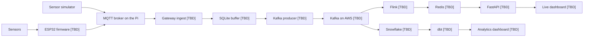

<p align="center">
  
</p>

<p align="center">
  
  
  
  
  
  
  
  
  
</p>

# Greenhouse IoT Streaming Pipeline

Soil moisture, soil temperature, air temperature, and relative humidity are collected at the edge, published to Kafka on AWS, and consumed on two paths. One path keeps a live view of the greenhouse. The other keeps a queryable history.

An ESP32 reads the sensors and publishes each reading to an MQTT broker on a Raspberry Pi Zero 2 W. The Pi is the gateway: it validates events, buffers them in SQLite, and publishes them to Kafka. From Kafka, Flink maintains current state in Redis for a FastAPI-backed dashboard, and a second consumer lands the same stream in Snowflake, where dbt builds the models behind the analytics dashboard.

The repo currently has the event schema and a sensor simulator that publishes that schema to MQTT. ESP32 firmware, gateway ingest, the Kafka producer, and both downstream paths are [TBD].

## Architecture



## Sensor event

Each event is one measurement. MQTT carries it today. Kafka will carry the same payload. The contract is [`schemas/sensor_event.schema.json`](schemas/sensor_event.schema.json). An example payload is [`schemas/sensor_event.example.json`](schemas/sensor_event.example.json).

| Field | Type | Meaning |
| --- | --- | --- |
| `schema_version` | integer | Always `1` |
| `event_id` | UUID | Unique id, used for deduplication |
| `sensor_id` | string | Sensor that took the reading |
| `gateway_id` | string | Raspberry Pi gateway that published it |
| `timestamp` | date-time | UTC time the measurement was taken |
| `measurement_type` | enum | Which reading this event carries |
| `value` | number | The reading |
| `unit` | enum | Unit of `value` |

Every field is required, and a payload cannot carry extra fields.

| `measurement_type` | `unit` |
| --- | --- |
| `soil_moisture` | `raw_capacitance` |
| `soil_temperature` | `celsius` |
| `air_temperature` | `celsius` |
| `relative_humidity` | `percent` |

Soil moisture stays in raw capacitance. It is not converted to a percentage on the event.

The simulator publishes three of these readings, once a second, under `gateway_id` `pi-001`:

| `sensor_id` | `measurement_type` |
| --- | --- |
| `soil-001` | `soil_moisture` |
| `bme280-001` | `air_temperature` |
| `bme280-001` | `relative_humidity` |

`soil_temperature` is in the schema. The simulator does not emit it yet. [TBD]

```json
{
  "schema_version": 1,
  "event_id": "550e8400-e29b-41d4-a716-446655440000",
  "sensor_id": "soil-001",
  "gateway_id": "pi-001",
  "timestamp": "2026-10-20T19:30:00Z",
  "measurement_type": "soil_moisture",
  "value": 475,
  "unit": "raw_capacitance"
}
```

## Sensor simulator

[`sensor_simulator/simulate.py`](sensor_simulator/simulate.py) stands in for the ESP32. It walks soil moisture, air temperature, and relative humidity inside fixed ranges, validates each event against the schema, and publishes it to the Pi's MQTT broker at QoS 1. Three events go out each second, sharing one timestamp.

```bash
python3 -m venv .venv
source .venv/bin/activate
pip install -r requirements.txt
cp .env.example .env
python3 sensor_simulator/simulate.py
```

Set these in `.env`. `.env` stays local.

| Variable | Used for |
| --- | --- |
| `MQTT_HOST` | Broker address |
| `MQTT_PORT` | Broker port. The example file uses `1883` |
| `MQTT_PASSWORD` | Password for the MQTT user |
| `MQTT_TOPIC` | Topic to publish. The gateway will subscribe to `greenhouse/telemetry` |

The simulator signs in as `greenhousepi`. `MQTT_USERNAME` is in `.env.example` and is unused. [TBD]

Stop the simulator with Ctrl+C.

## Gateway

[`gateway/ingest.py`](gateway/ingest.py) is a stub. It will subscribe to `greenhouse/telemetry`, validate each payload against the schema, drop duplicates, and insert the rest into SQLite so a later Kafka producer can drain the buffer. [TBD]

| Piece | Notes |
| --- | --- |
| SQLite path | [TBD] |
| Kafka topic | [TBD] |
| Kafka producer | [TBD] |

## Paths

Each path has its own consumer and its own store. The live view reads current state. The analytics view reads modeled history. A warehouse load and a dashboard query both stay off the raw stream. Both paths are [TBD].

### Live path

Kafka, then Flink, Redis, FastAPI, and the live dashboard. [TBD]

Flink reads the sensor stream and keeps the current picture of the greenhouse. Redis holds that state so the API can serve it with a cheap read. FastAPI exposes it to the live dashboard.

This path answers what is happening now: the latest reading from each sensor, and any rolling values computed on the stream.

### Analytics path

Kafka, then Snowflake, dbt, and the analytics dashboard. [TBD]

The same topics are loaded into Snowflake. dbt turns the landed events into models for trends, comparisons, and longer windows. The analytics dashboard reads those models.

This path answers what happened over hours, days, and seasons.

Snowflake ingest, dbt models, and both dashboard apps are [TBD].

## Components

| Component | Role | Status |
| --- | --- | --- |
| Sensors | Soil moisture, soil temperature, air temperature, and relative humidity | Schema only. Hardware [TBD] |
| Sensor simulator | Synthetic events published over MQTT | In [`sensor_simulator/simulate.py`](sensor_simulator/simulate.py) |
| ESP32 | Reads the sensors and publishes each reading to MQTT | [TBD] |
| MQTT broker | Runs on the Raspberry Pi Zero 2 W | [TBD] |
| Gateway ingest | Validates events, drops duplicates, buffers them in SQLite | Stub in [`gateway/ingest.py`](gateway/ingest.py) |
| Kafka producer | Drains SQLite and publishes to Kafka | [TBD] |
| Kafka on AWS | Durable log shared by both downstream paths | [TBD] |
| Flink | Stream processing for the live path | [TBD] |
| Redis | Current greenhouse state, read by the API | [TBD] |
| FastAPI | HTTP API in front of Redis for the live dashboard | [TBD] |
| Snowflake | Warehouse for landed sensor history | [TBD] |
| dbt | Models built from landed events for the analytics dashboard | [TBD] |
| Dashboards | Live view over FastAPI, historical view over dbt models | [TBD] |

## Data flow

1. The sensor simulator, or the ESP32 firmware [TBD], builds one event per measurement and validates it against the schema.
2. The event is published to the MQTT broker on the Raspberry Pi Zero 2 W.
3. Gateway ingest [TBD] checks the payload, drops duplicates, and writes it to SQLite.
4. A Kafka producer [TBD] reads that buffer and publishes to Kafka on AWS.
5. The live path [TBD] updates Redis through Flink. FastAPI serves that state to the live dashboard.
6. The analytics path [TBD] loads the same stream into Snowflake. dbt builds models for the analytics dashboard.

## Layout

```text
schemas/sensor_event.schema.json    event contract
schemas/sensor_event.example.json   example payload
sensor_simulator/simulate.py        MQTT publisher
gateway/ingest.py                   ingest stub
.env.example                        MQTT settings
requirements.txt                    Python dependencies
```
