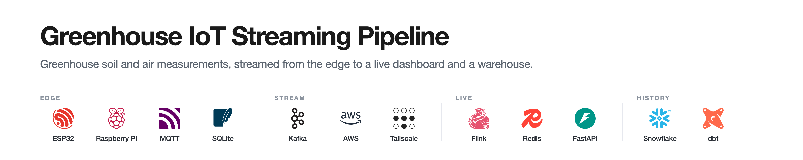
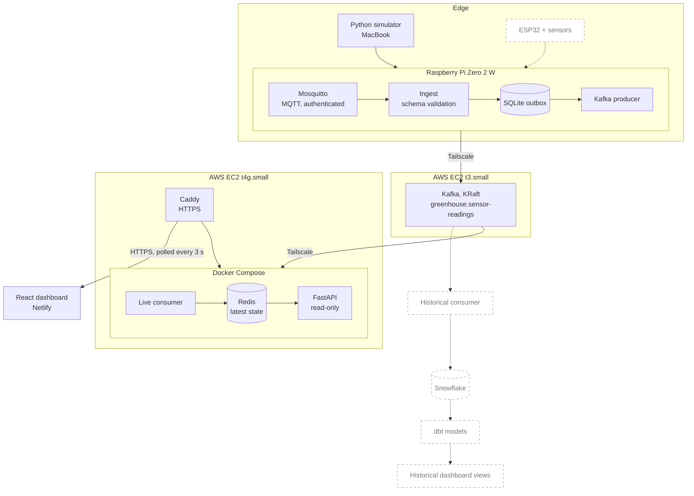

<p align="center">
  
</p>

<p align="center">
  
  
  
  
  
  
  
  
  
  
  
  
  
  
  <br>
  
  
  
</p>

# Greenhouse IoT Streaming Pipeline

An end-to-end streaming pipeline for greenhouse soil and air measurements. Events travel from MQTT through a durable Raspberry Pi outbox into Kafka on AWS. A consumer materializes the latest readings in Redis, FastAPI serves them, and a React dashboard displays them. A Snowflake and dbt branch for historical analytics is planned.

**Status:** the live path runs end to end on simulated data. Physical sensors and historical analytics are planned. See [Status and roadmap](#status-and-roadmap).

**Live:** [Dashboard](https://greenhouse.gregoryjoshua.com) · [API health](https://api.gregoryjoshua.com/health). Readings show as *Stale* when the simulator is not running.

## Architecture



Dashed nodes and edges are planned.

**Live path (implemented).** The Pi validates each event, stores it in SQLite, and publishes it to Kafka. A consumer on a second EC2 instance keeps the newest reading per sensor and metric in Redis. FastAPI reads only Redis, and the dashboard polls it every 3 seconds through Caddy.

**Historical path (planned).** A separate consumer group will load the same topic into Snowflake, and dbt will model it for historical views in the dashboard. Kafka's 7-day retention lets this consumer be added without changing the live path.

## Key engineering features

- **Durable edge buffering.** Ingest commits each valid event to SQLite before acknowledging MQTT, so a Kafka or network outage does not stop ingestion. Pending events stay on the Pi until Kafka confirms them.
- **At-least-once delivery, handled explicitly.** An event is marked published only after Kafka acknowledges it. Duplicates are possible after a crash, so every event carries a unique `event_id` for deduplication. See [Reliability](#reliability-and-testing).
- **Decoupled consumers.** Kafka separates the edge from consumers, and each consumer group tracks its own offsets.
- **Timestamp-safe latest state.** The consumer updates Redis with an atomic Lua script that ignores readings older than the stored one, so replays and out-of-order events cannot overwrite newer data. The Kafka offset is committed only after the Redis write.
- **Bounded Pi resources.** Batched publishing, a bounded retention job, and a health check cover memory, backlog, and disk on a small device.
- **Operations.** systemd manages the gateway, Docker Compose manages the backend, and Caddy provides HTTPS. A read-only script verifies deployments, and GitHub Actions runs the tests.

## Technology stack

| Layer | Implemented | Planned |
| --- | --- | --- |
| Devices | Python simulator | ESP32 Feather V2 with physical sensors |
| Messaging | Mosquitto (MQTT QoS 1), Apache Kafka (single-node KRaft) | Dead-letter handling |
| Storage | SQLite outbox, Redis with AOF persistence | Snowflake |
| Processing | Python Kafka consumer (`confluent-kafka`) | dbt models. Flink only if justified |
| Serving | FastAPI, Uvicorn, Caddy | |
| Frontend | React, Vite, Netlify | Historical views |
| Infrastructure | AWS EC2, Tailscale, Docker Compose, systemd | Terraform only if justified |
| Testing | pytest, GitHub Actions | Integration and failure-recovery tests |

## Data contract

Every message is one measurement, defined by the versioned JSON Schema [`schemas/sensor_event.schema.json`](schemas/sensor_event.schema.json). All fields are required, extra fields are rejected, and `schema_version` is currently `1`.

| `measurement_type` | `unit` |
| --- | --- |
| `soil_moisture` | `raw_capacitance` |
| `soil_temperature` | `celsius` |
| `air_temperature` | `celsius` |
| `relative_humidity` | `percent` |

```json
{
  "schema_version": 1,
  "event_id": "550e8400-e29b-41d4-a716-446655440000",
  "sensor_id": "soil-001",
  "gateway_id": "pi-001",
  "timestamp": "2026-10-20T19:30:00Z",
  "measurement_type": "soil_moisture",
  "value": 475,
  "unit": "raw_capacitance"
}
```

## Getting started

A full deployment spans a Raspberry Pi, two EC2 instances, and Netlify, so it cannot be started with one command. [`infrastructure/README.md`](infrastructure/README.md) covers deployment, networking, and operations. This section covers the essentials for each role.

**Prerequisites:** Python 3.11+, Docker with Compose for the backend, Node.js for the dashboard, Mosquitto on the Pi, and a reachable Kafka broker.

| Role | Runs on | Dependencies |
| --- | --- | --- |
| Simulator | MacBook | [`requirements/simulator.txt`](requirements/simulator.txt) |
| Gateway | Raspberry Pi | [`requirements/gateway.txt`](requirements/gateway.txt) |
| Kafka | EC2 | [`infrastructure/kafka/greenhouse.properties.example`](infrastructure/kafka/greenhouse.properties.example) |
| Live backend | EC2 | [`compose.yaml`](compose.yaml) |
| Dashboard | Netlify | [`dashboard/package.json`](dashboard/package.json) |

Copy [`.env.example`](.env.example) to `.env` and fill in the values for your role. The gateway treats a blank value as empty, not as a default.

```bash
# Simulator (MacBook): publishes about 3 events per second to the Pi's broker
python3 -m venv .venv && source .venv/bin/activate
pip install -r requirements/simulator.txt
python3 sensor_simulator/simulate.py

# Gateway (Raspberry Pi): install units, then enable the timers
pip install -r requirements/gateway.txt
sudo bash infrastructure/scripts/install-pi-services.sh
sudo systemctl enable --now greenhouse-cleanup.timer greenhouse-health.timer
bash infrastructure/scripts/verify-deployment.sh pi

# Live backend (EC2): consumer, Redis, and API
docker compose up -d --build
curl --fail http://127.0.0.1:8000/health

# Dashboard (local development)
cd dashboard && npm install && npm run dev
```

The dashboard's API URL is hard-coded in [`App.jsx`](dashboard/src/App.jsx), so local development reads the production API. Making it configurable is [TBD].

## Reliability and testing

| Hop | Mechanism | Guarantee |
| --- | --- | --- |
| Simulator to Mosquitto | MQTT QoS 1 | At-least-once |
| Mosquitto to SQLite | QoS 1 subscription, persistent session, manual acknowledgment after the SQLite commit | At-least-once. `event_id` is the primary key, so repeats are dropped |
| SQLite to Kafka | `acks=all`, idempotent producer, no new batch while one is in flight | At-least-once. Marked published only after Kafka acknowledges |
| Kafka to Redis | Offset committed after the Redis write, timestamp-guarded update | At-least-once with idempotent state |

- **Outbox.** [`ingest.py`](gateway/ingest.py) writes with `synchronous=FULL`. [`kafka_producer.py`](gateway/kafka_producer.py) sends the oldest pending events in batches of 100. After a Kafka outage, pending events are retried.
- **Duplicates.** The idempotent producer suppresses duplicates from its own retries. Other duplicates are possible, for example after a crash between Kafka's acknowledgment and the SQLite update. Consumers deduplicate on `event_id`.
- **Retention.** [`cleanup.py`](gateway/cleanup.py) runs hourly and deletes acknowledged events older than 24 hours in bounded batches. It never deletes pending events. Kafka retains data for 7 days.
- **Health checks.** [`health.py`](gateway/health.py) runs every minute and prints JSON with backlog size and age, ingestion and delivery freshness, database size, and disk use. It exits 0, 1, or 2 for healthy, warning, or critical.
- **Tests.** 16 [pytest](tests/gateway) tests cover cleanup and health logic. [GitHub Actions](.github/workflows/tests.yml) runs them on every push and pull request. Ingest, the producer, the consumer, and the API have no automated tests yet. [TBD]

**Limitations**
- Delivery is not exactly-once end to end.
- Kafka is a single node with replication factor 1. It is not highly available and does not protect against broker storage loss.
- Invalid MQTT events are logged and dropped, not quarantined. Dead-letter handling is planned.
- The Kafka producer and consumer use `PLAINTEXT` over Tailscale. MQTT on port 1883 is authenticated but not TLS-encrypted.
- There is no external outage alerting.
- Rebuilding Redis means replaying Kafka with a new consumer group. A tested procedure is [TBD].

## Status and roadmap

| Area | Status | Notes |
| --- | --- | --- |
| MQTT ingest, SQLite outbox, Kafka producer | Implemented | |
| Kafka broker | Implemented | Single-node KRaft, topic `greenhouse.sensor-readings`, 1 partition, replication factor 1, 7-day retention |
| Outbox retention and health checks | Implemented | systemd timers |
| Live consumer, Redis, FastAPI, Caddy | Implemented | Docker Compose, HTTPS |
| React dashboard | Implemented | Latest values with a 30-second stale indicator |
| Infrastructure configs and verification script | Implemented | [`infrastructure/`](infrastructure/) |
| Pi systemd units in the repo | In progress | Cleanup and health units are included. Ingest and producer units are being finalized |
| SQLite index migration | In progress | [`002_outbox_indexes.sql`](gateway/migrations/002_outbox_indexes.sql) is applied manually. There is no migration runner |
| Automated tests | In progress | Gateway only |
| ESP32 sensors | Planned | [TBD] |
| Snowflake ingestion, dbt models, historical views | Planned | [TBD] |
| Dead-letter handling, replay and recovery procedures | Planned | |
| Load test results, end-to-end latency | [TBD] | No measurements yet |
| Screenshots or demo GIF | [TBD] | |
| Flink, Terraform, expanded monitoring | Only if justified | |

## Repository structure

```text
.
├── gateway/                        Raspberry Pi services
│   ├── ingest.py                   MQTT to SQLite outbox
│   ├── kafka_producer.py           SQLite outbox to Kafka
│   ├── cleanup.py                  Retention job
│   ├── health.py                   Health check
│   └── migrations/                 SQL migrations
├── sensor_simulator/simulate.py    Synthetic event generator
├── consumers/live/                 Kafka to Redis consumer, dockerfile
├── api/                            FastAPI app, dockerfile
├── dashboard/                      React and Vite app
├── schemas/                        Event schema and example
├── infrastructure/                 Caddy, Kafka, Mosquitto, systemd, scripts, README
├── tests/gateway/                  pytest tests
├── .github/workflows/tests.yml     CI
├── requirements/                   Python dependencies per role
├── compose.yaml                    Redis, consumer, API
├── .env.example
└── assets/                         README images
```
