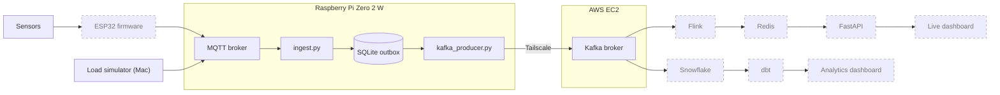

<p align="center">
  
</p>

<p align="center">
  
  
  
  
  
  
  
  
  
  
  
  
</p>

# Greenhouse IoT Streaming Pipeline

A streaming pipeline for greenhouse soil and air measurements. Readings are published over MQTT to a Raspberry Pi gateway, buffered in SQLite, and forwarded to Kafka on AWS. From Kafka, one path serves a live dashboard and another builds a queryable history in Snowflake.

**Status:** in progress. The edge, gateway, and Kafka legs work. Everything downstream of Kafka is **[TBD]**.

## Architecture



Dashed nodes are [TBD].

| Component | Role | Status |
| --- | --- | --- |
| Sensors and ESP32 | Read soil and air values and publish them to MQTT | [TBD] |
| Load simulator | Publishes synthetic events at volumes above the physical sensors | Working |
| MQTT broker | Entry point on the Pi | Working |
| Gateway ingest | Validates events and writes them to the SQLite outbox | Working |
| Kafka producer | Drains the outbox to Kafka | Working |
| Kafka | Durable log shared by both paths. Runs as a `systemd` service on EC2 | Working |
| Flink, Redis, FastAPI | Live path: current state behind a live dashboard | [TBD] |
| Snowflake, dbt | Analytics path: history and models behind a dashboard | [TBD] |

## Sensor event

Every message is one measurement, defined by [`schemas/sensor_event.schema.json`](schemas/sensor_event.schema.json). See [`schemas/sensor_event.example.json`](schemas/sensor_event.example.json).

| Field | Type | Meaning |
| --- | --- | --- |
| `schema_version` | integer | Always `1` |
| `event_id` | UUID | Unique id, used for deduplication |
| `sensor_id` | string | Sensor that took the reading |
| `gateway_id` | string | Gateway that published it |
| `timestamp` | date-time | UTC time of the measurement |
| `measurement_type` | enum | See below |
| `value` | number | The reading |
| `unit` | enum | Unit of `value` |

All fields are required and extra fields are rejected.

| `measurement_type` | `unit` |
| --- | --- |
| `soil_moisture` | `raw_capacitance` |
| `soil_temperature` | `celsius` |
| `air_temperature` | `celsius` |
| `relative_humidity` | `percent` |

Soil moisture stays in raw capacitance and is not converted to a percentage.

```json
{
  "schema_version": 1,
  "event_id": "550e8400-e29b-41d4-a716-446655440000",
  "sensor_id": "soil-001",
  "gateway_id": "pi-001",
  "timestamp": "2026-10-20T19:30:00Z",
  "measurement_type": "soil_moisture",
  "value": 475,
  "unit": "raw_capacitance"
}
```

## Environment setup

The simulator and the gateway have separate dependencies and run on different machines. Both need Python 3.11+ and read one `.env` file at the repo root.

### Load simulator (macOS)

[`sensor_simulator/simulate.py`](sensor_simulator/simulate.py) runs on a Mac and publishes schema-valid synthetic events to the Pi's MQTT broker. It exists to exercise the pipeline at volumes the physical sensors cannot produce, so throughput and backpressure can be tested before the full sensor set is installed.

It currently emits soil moisture, air temperature, and relative humidity at about three events per second. A configurable rate and `soil_temperature` are [TBD].

```bash
cd sensor_simulator
python3 -m venv .venv
source .venv/bin/activate
pip install -r requirements.txt
cd ..
cp .env.example .env
python3 sensor_simulator/simulate.py
```

### Gateway (Raspberry Pi)

Requires Raspberry Pi OS and a Mosquitto broker on port 1883. Run both services; they are independent processes.

```bash
cd gateway
python3 -m venv .venv
source .venv/bin/activate
pip install -r requirements.txt
cd ..
cp .env.example .env
python3 gateway/ingest.py          # MQTT -> SQLite
python3 gateway/kafka_producer.py  # SQLite -> Kafka
```

Running both as `systemd` services on the Pi is [TBD].

### Configuration

| Variable | Used by | Notes |
| --- | --- | --- |
| `MQTT_HOST`, `MQTT_PORT` | Simulator | Address of the Pi's broker. Port is `1883` |
| `MQTT_USERNAME`, `MQTT_PASSWORD` | Both | Broker credentials |
| `MQTT_TOPIC` | Simulator | Use `greenhouse/telemetry`, which is what the gateway subscribes to |
| `KAFKA_BOOTSTRAP_SERVERS` | Producer | Broker address on the tailnet |
| `KAFKA_TOPIC` | Producer | Use `greenhouse.sensor-readings` |
| `KAFKA_BATCH_SIZE` | Producer | Events per batch. Use `100` |
| `KAFKA_RETRY_SECONDS` | Producer | Wait after a failed batch. Use `5` |

Fill in every value. A blank value is read as empty rather than falling back to the default.

## Gateway

The Pi accepts readings whether or not the cloud is reachable.

- **Ingest.** [`ingest.py`](gateway/ingest.py) subscribes to `greenhouse/telemetry`, validates each event against the schema, and inserts it into a SQLite outbox keyed by `event_id`. Invalid events and duplicates are dropped.
- **Outbox.** SQLite decouples sensor ingestion from Kafka availability. If the broker or the link is down, events accumulate on disk and ingestion carries on.
- **Producer.** [`kafka_producer.py`](gateway/kafka_producer.py) selects events where `kafka_published_at IS NULL` in batches of 100, oldest first. Batching keeps memory on the Pi bounded, however large the backlog.
- **Acknowledgment.** An event is marked published only after Kafka confirms delivery (`acks=all`). Unconfirmed events stay pending and are retried.

### Delivery

Delivery is at-least-once. Producer idempotence suppresses duplicates caused by the Kafka client's own retries. A duplicate can still occur in other cases, for example a crash after Kafka acknowledges an event but before SQLite records it. `event_id` is unique per event, so downstream consumers deduplicate on it.

### Known limits

- **Disk is the limit during a long outage.** There are no capacity limits, disk monitoring, or full-storage policy yet. [TBD]
- **No outbox cleanup yet.** Planned: a script that deletes acknowledged records older than 24 hours. It will never delete unacknowledged records because of age. [TBD]

## Kafka and networking

Kafka runs as a `systemd` service on an EC2 instance. The Pi reaches it over a Tailscale tunnel, which encrypts the connection, so the producer uses `PLAINTEXT` and `KAFKA_BOOTSTRAP_SERVERS` is the broker's tailnet address. Topic partitions and retention are [TBD].

## Downstream paths

Both paths read from Kafka and are [TBD].

- **Live:** Flink maintains current state in Redis. FastAPI serves it to the live dashboard.
- **Analytics:** Kafka is loaded into Snowflake. dbt builds models for the analytics dashboard. The loading method is [TBD].

## Repository layout

```text
assets/                            header image and badges
gateway/ingest.py                  MQTT to SQLite outbox
gateway/kafka_producer.py          SQLite outbox to Kafka
gateway/requirements.txt           Pi dependencies
sensor_simulator/simulate.py       load simulator
sensor_simulator/requirements.txt  Mac dependencies
schemas/                           event schema and example
.env.example                       shared settings
```
