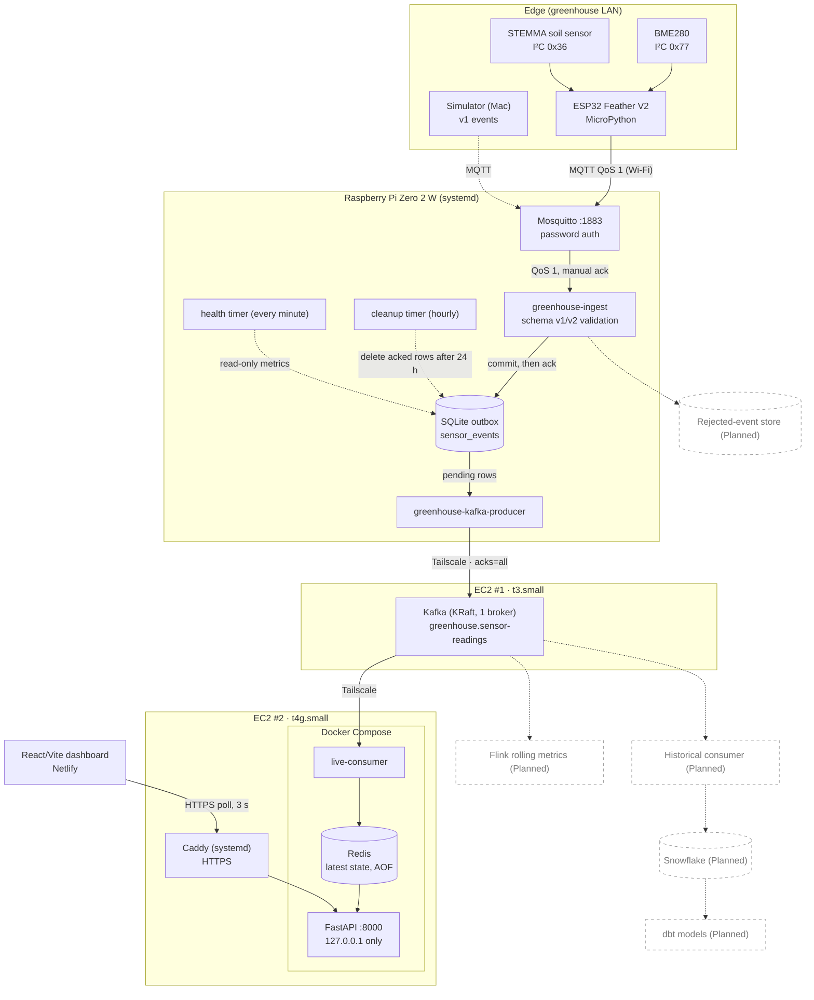

# Architecture

How the pipeline is built and why. This document describes what the code does today; planned work is labelled **Planned**.

Related documents: [Data contracts](data-contracts.md) · [Adding a sensor](adding-a-sensor.md) · [Deployment](deployment.md) · [Operations](operations.md) · [ADRs](decisions/README.md)

## System overview

Solid boxes exist in the repository. Dashed boxes marked **Planned** do not. Dotted arrows between implemented components (cleanup, health) are side channels, not event flow.

## Components

| Component | Responsibility | Runs on | Status | Code |
| --- | --- | --- | --- | --- |
| ESP32 firmware | Read sensors, build schema v2 events (one per measurement), sync time via NTP, publish with MQTT QoS 1 | ESP32 Feather V2 (MicroPython) | Implemented. Unattended boot on external power is still being validated | [`firmware/esp32/`](../firmware/esp32/) |
| Simulator | Generate synthetic schema v1 events (3 per second) | Mac | Implemented. Validates against schema v1 and publishes with the same `sensor_id`s as the physical sensors (see [Deployment](deployment.md#simulator)) | [`sensor_simulator/simulate.py`](../sensor_simulator/simulate.py) |
| Mosquitto | MQTT broker; authenticated, plain TCP on 1883, no ACLs | Pi | Implemented | [`infrastructure/mosquitto/greenhouse.conf`](../infrastructure/mosquitto/greenhouse.conf) |
| Ingest | Subscribe, validate against v1/v2 schema, insert into SQLite, then acknowledge | Pi, systemd | Implemented | [`gateway/ingest.py`](../gateway/ingest.py) |
| SQLite outbox | Durable buffer between MQTT and Kafka | Pi | Implemented | `gateway/data/sensor_events.db` (git-ignored) |
| Kafka producer | Publish pending rows to Kafka; mark rows only after broker acknowledgment | Pi, systemd | Implemented | [`gateway/kafka_producer.py`](../gateway/kafka_producer.py) |
| Cleanup | Delete Kafka-acknowledged rows older than 24 h | Pi, systemd timer | Implemented, unit-tested | [`gateway/cleanup.py`](../gateway/cleanup.py) |
| Health check | Emit JSON status (backlog, freshness, disk); exit 0/1/2 | Pi, systemd timer | Implemented, unit-tested | [`gateway/health.py`](../gateway/health.py) |
| Kafka broker | Single-node KRaft broker; topic `greenhouse.sensor-readings` | EC2 #1 | Implemented | [`infrastructure/kafka/greenhouse.properties.example`](../infrastructure/kafka/greenhouse.properties.example) |
| Live consumer | Consume topic, maintain latest value per sensor/measurement in Redis | EC2 #2, Docker Compose | Implemented | [`consumers/live/consumer.py`](../consumers/live/consumer.py) |
| Redis | Latest-state materialized view | EC2 #2, Docker Compose | Implemented | [`compose.yaml`](../compose.yaml) |
| FastAPI | Read-only HTTP API over Redis | EC2 #2, Docker Compose | Implemented | [`api/main.py`](../api/main.py) |
| Caddy | HTTPS reverse proxy to `127.0.0.1:8000` | EC2 #2, systemd | Implemented | [`infrastructure/caddy/caddyfile`](../infrastructure/caddy/caddyfile) |
| Dashboard | Poll API every 3 s, render cards, mark readings older than 30 s as stale | Netlify | Implemented | [`dashboard/src/App.jsx`](../dashboard/src/App.jsx) |
| Tailscale | Private network between Pi, Kafka host, and serving host | Pi, both EC2 hosts | In use; not configured by this repo | n/a |
| Rejected-event storage | Persist invalid payloads and errors | Pi | **Planned** | n/a |
| Flink | Event-time rolling metrics | TBD | **Planned** | n/a |
| Historical consumer, Snowflake, dbt | Warehouse and analytics | TBD | **Planned** | n/a |

## Event flow

1. **Sample.** Every `SAMPLE_INTERVAL_SECONDS` (default 5), `main.py` calls `sensors.read_all()`. The BME280 yields three measurements and the soil sensor one. `main.py` stamps them with one UTC timestamp, a random UUIDv4 `event_id`, `gateway_id`, and `schema_version: 2`.
2. **Publish.** Each measurement becomes its own JSON message on topic `greenhouse/telemetry`, published QoS 1. `umqtt.simple` blocks until the broker's PUBACK; the event is dropped from the in-RAM list only after that.
3. **Ingest.** `ingest.py` holds a persistent MQTT session (`clean_session=False`, client id `pi-sqlite-ingestor`, QoS 1 subscription, `manual_ack=True`). For each message it parses JSON, picks the schema by `schema_version`, and validates.
4. **Persist, then acknowledge.** `INSERT OR IGNORE` into `sensor_events` (`event_id` primary key, `synchronous=FULL`). The MQTT ack is sent only after the transaction commits. Invalid messages are logged, acknowledged, and dropped.
5. **Produce.** `kafka_producer.py` reads up to `KAFKA_BATCH_SIZE` (default 100) rows where `kafka_published_at IS NULL`, ordered by `received_at, event_id`. It sends them with key `event_id` and the stored JSON as the value, waits for every delivery callback, then sets `kafka_published_at` for acknowledged rows only. It does not start a new batch while the previous one has unresolved messages.
6. **Consume.** `consumer.py` polls Kafka, checks the fields the live view needs, and runs an atomic Lua script that updates the Redis hash `greenhouse:latest:{gateway_id}:{sensor_id}:{measurement_type}` unless the stored `timestamp_ms` is newer. It commits the Kafka offset synchronously after Redis responds.
7. **Serve.** `GET /api/v1/sensors/latest` scans `greenhouse:latest:*`, pipelines `HGETALL`, and returns `{count, readings[]}` sorted by gateway, sensor, and measurement. `GET /health` pings Redis.
8. **Display.** The dashboard fetches the endpoint every 3 s. A reading is stale when its event timestamp is more than 30 s old. If a fetch fails, the last known readings stay on screen with an "Offline" status.

Background tasks on the Pi run independently of this flow: `greenhouse-cleanup.timer` (hourly) and `greenhouse-health.timer` (every minute).

## Communication and dependencies

| From | To | Protocol | Auth / transport | Notes |
| --- | --- | --- | --- | --- |
| ESP32 | Mosquitto | MQTT 3.1.1, port 1883 | Username/password, no TLS | Uses the Pi's LAN address |
| Ingest | Mosquitto | MQTT 3.1.1, `localhost:1883` | Username/password from `.env` | Host and topic are hard-coded in `ingest.py` |
| Producer | Kafka | Kafka protocol, `PLAINTEXT`, port 9092 | Tailscale network | `acks=all`, idempotent producer |
| Consumer | Kafka | Kafka protocol, `PLAINTEXT` | Tailscale network | Own consumer group; manual offset commits |
| Consumer, API | Redis | Redis protocol, port 6379 | Internal Docker network only | Redis publishes no host port |
| Caddy | FastAPI | HTTP | `127.0.0.1:8000` | Compose binds the API to loopback |
| Dashboard | Caddy | HTTPS | Public; CORS allow-list on the API | API URL is hard-coded in `App.jsx` |

Startup dependencies: ingest requires `mosquitto.service`. The producer expects network and `tailscaled`. In Compose, the consumer and API wait for Redis to be healthy, but nothing waits for Kafka; the Kafka client reconnects on its own.

Each hop is decoupled by a durable or restartable boundary: SQLite absorbs Kafka and WAN outages, Kafka absorbs consumer outages, and Redis can be rebuilt from Kafka. The API does not talk to Kafka.

## What is stored where

| Store | Contents | Purpose | Lifetime |
| --- | --- | --- | --- |
| SQLite `sensor_events` (Pi) | One row per accepted event: `event_id` (PK), `event_json`, `received_at` (Pi UTC), `kafka_published_at` (NULL until Kafka acknowledges) | Outbox. Accepts events while Kafka or the WAN is down, and deduplicates by `event_id` | Pending rows are kept indefinitely. Acknowledged rows are deleted after 24 h. This is not a history store |
| Kafka topic `greenhouse.sensor-readings` (EC2 #1) | Full event JSON as value, `event_id` as key. One partition, replication factor 1 | Decouples producer from consumers; allows replay and additional consumer groups | 168 h by `log.retention.hours` in the template (topic-level overrides on the running broker could not be verified from the repo) |
| Redis (EC2 #2) | One hash per `gateway_id`/`sensor_id`/`measurement_type`: `value`, `unit`, `timestamp`, `timestamp_ms`, `event_id`, `sensor_id`, `gateway_id`, `measurement_type` | Low-latency latest-state view for the API. Derived data, rebuildable from Kafka | AOF persistence on a Docker volume (`redis_data`). Keys have no TTL, so a retired sensor stays visible (as stale) until its key is deleted |

SQLite indexes live in [`gateway/migrations/002_outbox_indexes.sql`](../gateway/migrations/002_outbox_indexes.sql). No migration runner or schema-version table exists; the migration is applied by hand (see [Deployment](deployment.md#raspberry-pi-gateway)).

## Delivery guarantees

The pipeline provides **at-least-once** delivery from the Pi onward. It does not provide exactly-once delivery, and nothing before the Pi's SQLite commit is durable.

| Hop | Acknowledgment | Failure behavior |
| --- | --- | --- |
| ESP32 → Mosquitto | QoS 1 PUBACK from the broker | The event stays in a RAM list and is retried after reconnect. A reset loses it. The device holds at most one sampling cycle (≤ 4 events), and stops sampling while Wi-Fi or MQTT is down, so there is no backlog |
| Mosquitto → ingest | Manual ack after SQLite commit | If ingest is down, Mosquitto queues for the persistent session. Mosquitto's queue limits (not set in this repo) apply. If the process dies after commit but before the ack, the message is redelivered and ignored as a duplicate |
| Ingest → SQLite | `synchronous=FULL`, ack after commit | A SQLite error is logged and re-raised, which terminates the process. systemd restarts it, and the unacknowledged message is redelivered |
| SQLite → Kafka | Per-message delivery callback, `acks=all`, idempotent producer | Failed or unconfirmed rows stay pending and are retried (`KAFKA_RETRY_SECONDS`, default 5). `delivery.timeout.ms` defaults to 60 000 ms |
| Kafka → Redis | Offset committed after the Redis write | A Redis error terminates the consumer. Docker restarts it and the uncommitted message is reprocessed |

**Duplicates.** Duplicates are possible at the ESP32 (a publish succeeds but the ack is lost), in Kafka (the producer crashes after delivery but before the `kafka_published_at` update; Kafka does not deduplicate by key), and at the consumer (redelivery after a crash). Current handling:

- SQLite deduplicates by `event_id` (`INSERT OR IGNORE`).
- Redis writes are idempotent: an update is skipped only when the stored `timestamp_ms` is strictly newer, so replays cannot regress state.
- Nothing deduplicates in Kafka. Any future consumer that aggregates (Flink, Snowflake loads, dbt) must deduplicate on `event_id`. **Planned**.

**Ordering.** Kafka order is arrival order at the Pi, not event time. After an outage, the backlog drains oldest-first. Redis keeps the greatest event timestamp, so the dashboard converges to the newest reading.

**Clock dependence.** The Redis guard trusts event timestamps. A reading with a timestamp in the future blocks later updates to that key until real time catches up. The firmware only checks that the year is at least 2025.

**Invalid data.** Ingest drops invalid events after logging; the consumer skips malformed events after logging. Neither retains the payload. See [Data contracts](data-contracts.md#how-invalid-events-are-handled).

## Failure handling summary

| Failure | Effect | Recovery |
| --- | --- | --- |
| Wi-Fi or Pi unreachable from ESP32 | No readings taken while disconnected | Automatic reconnect with a 5 s retry loop |
| Ingest service down | Mosquitto queues messages for its persistent session | systemd `Restart=on-failure` |
| Kafka or Tailscale down | Rows accumulate as pending in SQLite; health check warns at 60 s of backlog age and goes critical at 300 s | Automatic, producer retries every 5 s |
| Consumer or Redis down | Kafka retains events; offsets stay uncommitted | Docker `restart: unless-stopped`, then the consumer resumes from its committed offset |
| Redis data lost | Dashboard empty or partial | Replay from Kafka with a new consumer group, or reset offsets. The procedure is untested (**TBD**) |
| Kafka broker lost | Data on the single broker is at risk | No replication. Pending rows younger than 24 h after acknowledgment may still be on the Pi |

Diagnostic procedures: [Operations](operations.md).

## Planned components

These are not implemented. The roadmap lives in the root [README](../README.md#roadmap).

- **Rejected-event storage.** Persist invalid MQTT payloads and validation errors (separate SQLite table or dead-letter mechanism) with bounded retention.
- **Flink.** Event-time rolling metrics for the live dashboard.
- **Historical path.** A second consumer group loading Snowflake, with dbt models and historical dashboard views.
- **Firmware reliability.** Persistent edge buffering, bounded network timeouts, and per-sensor failure isolation.
- **CI/CD beyond tests.** Build, validation, and deployment automation for the Pi and EC2 hosts. See [Deployment](deployment.md#current-state-and-planned-automation).

## Implementation notes

- **Schema registry.** Gateway schemas are loaded from `schemas/` at process start into a hard-coded `{1: ..., 2: ...}` dict. A new version requires a code change and an ingest restart.
- **Version-agnostic downstream.** The producer forwards stored JSON verbatim. The consumer checks only seven fields and ignores `schema_version`, measurement type, and unit. The API and dashboard likewise pass through unknown measurement types. This is why most new sensors need no downstream changes ([Adding a sensor](adding-a-sensor.md#what-needs-to-change)).
- **Gateway identity.** The ESP32 sets `gateway_id` from its own `config.py`. `health.py` hard-codes `pi-001`.
- **Health coverage.** The health check observes only the Pi's outbox. It does not check Kafka, the consumer, Redis, the API, or the ESP32. There is no external alerting (**Planned**).
- **Tests.** Automated tests cover `gateway/cleanup.py` and `gateway/health.py` only.
