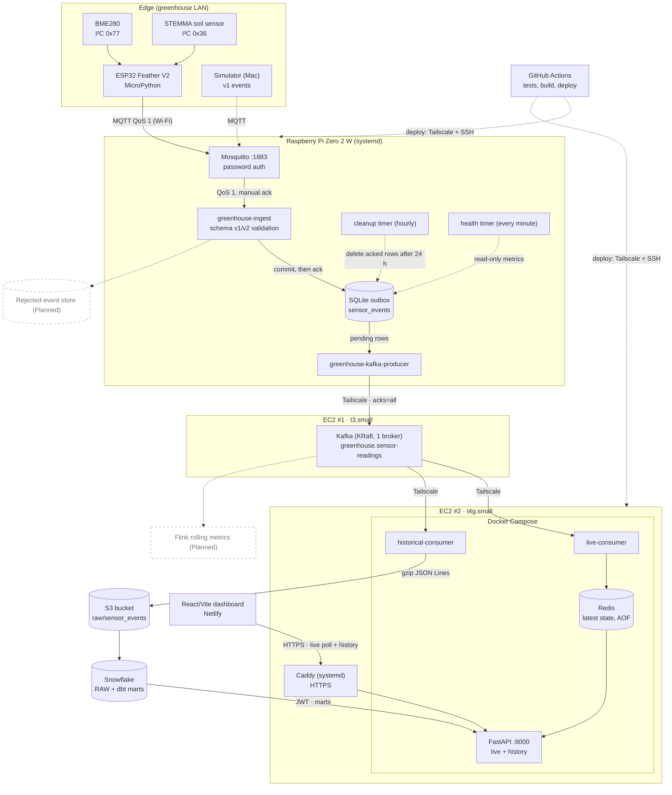

# Architecture

How the pipeline is built and why. This document describes how the implementation works. Planned work is tracked in the [roadmap](../README.md#roadmap).

Related documents: [Data contracts](data-contracts.md) · [Adding a sensor](adding-a-sensor.md) · [Deployment](deployment.md) · [Operations](operations.md) · [ADRs](decisions/README.md)

## System overview

Solid boxes are implemented. Dashed boxes are planned (see the [roadmap](../README.md#roadmap)). Dotted arrows are side channels (cleanup, health, deployment), not event flow.

## Components

| Component | Responsibility | Runs on | Status | Code |
| --- | --- | --- | --- | --- |
| ESP32 firmware | Read sensors, build schema v2 events (one per measurement), sync time via NTP, publish with MQTT QoS 1 | ESP32 Feather V2 (MicroPython) | Implemented. Each sensor initializes, reads, and recovers independently | [`firmware/esp32/`](../firmware/esp32/) |
| Simulator | Generate synthetic schema v1 events (3 per second) | Mac | Implemented. Validates against schema v1; uses `sim-` prefixed gateway and sensor IDs so simulated events are distinguishable from real ones (see [Deployment](deployment.md#simulator)) | [`sensor_simulator/simulate.py`](../sensor_simulator/simulate.py) |
| Mosquitto | MQTT broker; password authentication, plain TCP on 1883 | Pi | Implemented | [`infrastructure/mosquitto/greenhouse.conf`](../infrastructure/mosquitto/greenhouse.conf) |
| Ingest | Subscribe, validate against v1/v2 schema, insert into SQLite, then acknowledge | Pi, systemd | Implemented | [`gateway/ingest.py`](../gateway/ingest.py) |
| SQLite outbox | Durable buffer between MQTT and Kafka | Pi | Implemented | `gateway/data/sensor_events.db` (git-ignored) |
| Kafka producer | Publish pending rows to Kafka; mark rows only after broker acknowledgment | Pi, systemd | Implemented | [`gateway/kafka_producer.py`](../gateway/kafka_producer.py) |
| Cleanup | Delete Kafka-acknowledged rows older than 24 h | Pi, systemd timer | Implemented, tested | [`gateway/cleanup.py`](../gateway/cleanup.py) |
| Health check | Emit JSON status (backlog, freshness, disk); exit 0/1/2 | Pi, systemd timer | Implemented, tested | [`gateway/health.py`](../gateway/health.py) |
| Kafka broker | Single-node KRaft broker; topic `greenhouse.sensor-readings` | EC2 #1, systemd | Implemented | [`infrastructure/kafka/greenhouse.properties.example`](../infrastructure/kafka/greenhouse.properties.example), [`infrastructure/systemd/kafka_EC2/kafka.service`](../infrastructure/systemd/kafka_EC2/kafka.service) |
| Live consumer | Consume topic, maintain latest value per sensor/measurement in Redis | EC2 #2, Docker Compose | Implemented | [`consumers/live/consumer.py`](../consumers/live/consumer.py) |
| Redis | Latest-state materialized view | EC2 #2, Docker Compose | Implemented | [`compose.yaml`](../compose.yaml) |
| Historical consumer | Consume the topic in its own group, batch events, upload gzip JSON Lines to S3, commit after upload | EC2 #2, Docker Compose | Implemented | [`consumers/historical/consumer.py`](../consumers/historical/consumer.py) |
| S3 bucket | Durable raw archive of every event | AWS | In use; bucket and IAM are configured outside this repo | n/a |
| FastAPI | Read-only HTTP API: live readings from Redis, historical series from Snowflake marts | EC2 #2, Docker Compose | Implemented | [`api/`](../api/) |
| Caddy | HTTPS reverse proxy to `127.0.0.1:8000` | EC2 #2, systemd | Implemented | [`infrastructure/caddy/caddyfile`](../infrastructure/caddy/caddyfile) |
| Dashboard | Live tab polls every 3 s and marks readings older than 30 s stale; History tab charts `/api/v1/history/series` with weighted summaries | Netlify | Implemented | [`dashboard/`](../dashboard/) |
| Tailscale | Private network between Pi, Kafka host, and serving host; CI also joins it to reach the deploy targets | Pi, both EC2 hosts, CI runners | In use | n/a |
| GitHub Actions | Run tests and the dashboard build; on `main`, deploy the Pi gateway services and the serving containers | GitHub-hosted runners | Implemented | [`.github/workflows/ci-cd.yml`](../.github/workflows/ci-cd.yml) |
| Tests | pytest suites for schemas, ingest, cleanup, health, the live consumer, and the API | CI and local | Implemented | [`tests/`](../tests/) |
| Rejected-event storage | Persist invalid payloads and errors | Pi | Planned | n/a |
| Flink | Event-time rolling metrics | TBD | Planned | n/a |
| Snowflake | Warehouse: raw events loaded from S3, queried by the API | Snowflake (cloud) | In use; account, load, and IAM are outside this repo | n/a |
| dbt | Staging, intermediate, and mart models over the raw Snowflake table | Local / CI or host with profiles | Implemented | [`warehouse/`](../warehouse/) |

## Event flow

1. **Sample.** Every `SAMPLE_INTERVAL_SECONDS` (default 5), `main.py` calls `sensors.read_all(devices)`. Each sensor is read independently: the BME280 yields three measurements and the soil sensor one. A sensor that is missing or fails a read is skipped and re-initialized every `SENSOR_RETRY_SECONDS` (30) while the others keep publishing. `main.py` stamps the measurements with one UTC timestamp, a random UUIDv4 `event_id`, `gateway_id`, and `schema_version: 2`.
2. **Publish.** Each measurement becomes its own JSON message on topic `greenhouse/telemetry`, published QoS 1. `umqtt.simple` blocks until the broker's PUBACK; the event is dropped from the in-RAM list only after that. If Wi-Fi, NTP, or MQTT fails, the loop disconnects, schedules a retry in 5 s, and resumes without restarting the program.
3. **Ingest.** `ingest.py` holds a persistent MQTT session (`clean_session=False`, client id `pi-sqlite-ingestor`, QoS 1 subscription, `manual_ack=True`). For each message it parses JSON, picks the schema by `schema_version`, and validates.
4. **Persist, then acknowledge.** `INSERT OR IGNORE` into `sensor_events` (`event_id` primary key, `synchronous=FULL`). The MQTT ack is sent only after the transaction commits. Invalid messages are logged, acknowledged, and dropped.
5. **Produce.** `kafka_producer.py` reads up to `KAFKA_BATCH_SIZE` (default 100) rows where `kafka_published_at IS NULL`, ordered by `received_at, event_id`. It sends them with key `event_id` and the stored JSON as the value, waits for every delivery callback, then sets `kafka_published_at` for acknowledged rows only. It does not start a new batch while the previous one has unresolved messages.
6. **Consume.** `consumer.py` polls Kafka, checks the fields the live view needs, and runs an atomic Lua script that updates the Redis hash `greenhouse:latest:{gateway_id}:{sensor_id}:{measurement_type}` unless the stored `timestamp_ms` is newer. It commits the Kafka offset synchronously after Redis responds.
7. **Archive.** `consumers/historical/consumer.py` reads the same topic in group `greenhouse-historical`. It buffers events per partition and flushes when a batch reaches `HISTORICAL_BATCH_SIZE` (240) events or is `HISTORICAL_FLUSH_SECONDS` (300) old. A batch becomes one gzip-compressed JSON Lines object at `s3://$S3_BUCKET/raw/sensor_events/year=YYYY/month=MM/day=DD/<topic>/partition=N/offsets-<first>-<last>.jsonl.gz`; each line is the original event plus `_kafka_topic`, `_kafka_partition`, and `_kafka_offset`. The Kafka offset is committed synchronously only after `put_object` returns. On SIGTERM it flushes pending batches before closing.
8. **Warehouse.** Objects in S3 are loaded into Snowflake `GREENHOUSE_ANALYTICS.RAW.SENSOR_EVENTS`. The dbt project in [`warehouse/`](../warehouse/) deduplicates on `event_id` and builds marts such as `FCT_SENSOR_HOURLY` and `FCT_SENSOR_DAILY` (schema name from the dbt profile; the API defaults to `GREENHOUSE_DBT_MARTS`).
9. **Serve (live).** `GET /api/v1/sensors/latest` scans `greenhouse:latest:*`, pipelines `HGETALL`, and returns `{count, readings[]}` sorted by gateway, sensor, and measurement. `GET /health` pings Redis only.
10. **Serve (history).** `GET /api/v1/history/series` queries Snowflake marts for `period` `24h`, `7d`, or `30d` (hourly or daily grain). The API opens a JWT connection with the RSA key mounted at `/run/secrets/snowflake_api_key.pem` ([`api/repositories/snowflake.py`](../api/repositories/snowflake.py)).
11. **Display.** The dashboard **Live** tab fetches the live endpoint every 3 s. A reading is stale when its event timestamp is more than 30 s old. If a fetch fails, the last known readings stay on screen with an "Offline" status. The **History** tab calls `GET /api/v1/history/series` for sensor/measurement/period trends (avg line, min–max band, weighted summaries). Sensor options for History are discovered from the live payload.

Background tasks on the Pi run independently of this flow: `greenhouse-cleanup.timer` (hourly) and `greenhouse-health.timer` (every minute).

## Communication and dependencies

| From | To | Protocol | Auth / transport | Notes |
| --- | --- | --- | --- | --- |
| ESP32 | Mosquitto | MQTT 3.1.1, port 1883 | Username/password, no TLS | Uses the Pi's LAN address |
| Ingest | Mosquitto | MQTT 3.1.1, `localhost:1883` | Username/password from `.env` | Always `localhost`; port and topic default to 1883 and `greenhouse/telemetry`, overridable in `.env` |
| Producer | Kafka | Kafka protocol, `PLAINTEXT`, port 9092 | Tailscale network | `acks=all`, idempotent producer |
| Live consumer | Kafka | Kafka protocol, `PLAINTEXT` | Tailscale network | Group `LIVE_KAFKA_CONSUMER_GROUP`; manual offset commits |
| Historical consumer | Kafka | Kafka protocol, `PLAINTEXT` | Tailscale network | Group `HISTORICAL_KAFKA_CONSUMER_GROUP`; manual offset commits |
| Historical consumer | S3 | HTTPS | AWS credentials from the EC2 instance profile | Region `AWS_REGION` |
| Consumer, API | Redis | Redis protocol, port 6379 | Internal Docker network only | Redis publishes no host port |
| API | Snowflake | HTTPS / Snowflake protocol | JWT (`SNOWFLAKE_JWT`) with RSA key from a host path mounted into the container | Key path and passphrase from `.env`; connection opened on demand |
| Caddy | FastAPI | HTTP | `127.0.0.1:8000` | Compose binds the API to loopback |
| GitHub Actions | Pi, serving host | SSH over Tailscale | Ephemeral Tailscale node tagged `tag:ci`; deploy keys | `main` only, after tests pass |
| Dashboard | Caddy | HTTPS | Public; CORS allow-list on the API | API origin from `VITE_API_URL` / `VITE_API_BASE_URL`, default production host ([`dashboard/src/api/config.js`](../dashboard/src/api/config.js)) |

Startup dependencies: ingest requires `mosquitto.service`. The producer expects network and `tailscaled`. In Compose, the consumer and API wait for Redis to be healthy; the Kafka client reconnects on its own.

Each hop is decoupled by a durable or restartable boundary: SQLite absorbs Kafka and WAN outages, Kafka absorbs consumer outages, and Redis can be rebuilt from Kafka. The API does not talk to Kafka.

## What is stored where

| Store | Contents | Purpose | Lifetime |
| --- | --- | --- | --- |
| SQLite `sensor_events` (Pi) | One row per accepted event: `event_id` (PK), `event_json`, `received_at` (Pi UTC), `kafka_published_at` (NULL until Kafka acknowledges) | Outbox. Accepts events while Kafka or the WAN is down, and deduplicates by `event_id` | Pending rows are kept indefinitely. Acknowledged rows are deleted after 24 h. This is not a history store |
| Kafka topic `greenhouse.sensor-readings` (EC2 #1) | Full event JSON as value, `event_id` as key. One partition, replication factor 1 | Decouples producer from consumers; allows replay and additional consumer groups | 168 h by `log.retention.hours` in the template |
| S3 `raw/sensor_events/` | One `.jsonl.gz` object per flushed batch, partitioned by UTC date, topic, and partition, named by offset range. Lines are full events plus Kafka lineage fields | Permanent raw archive and source for the Snowflake load. Duplicates are possible across objects | Governed by the bucket's lifecycle rules, not by this repo |
| Snowflake `RAW.SENSOR_EVENTS` | Parsed event fields plus Kafka lineage and load metadata | Warehouse landing table for dbt | Retention managed in Snowflake |
| Snowflake dbt marts | Hourly and daily aggregates (`FCT_SENSOR_HOURLY`, `FCT_SENSOR_DAILY`, quality marts) | Analytics grain for the history API | Rebuilt by `dbt run` |
| Redis (EC2 #2) | One hash per `gateway_id`/`sensor_id`/`measurement_type`: `value`, `unit`, `timestamp`, `timestamp_ms`, `event_id`, `sensor_id`, `gateway_id`, `measurement_type` | Low-latency latest-state view for the live API. Derived data, rebuildable from Kafka | AOF persistence on a Docker volume (`redis_data`). Keys have no TTL; a retired sensor's key is deleted manually |

SQLite indexes live in [`gateway/migrations/002_outbox_indexes.sql`](../gateway/migrations/002_outbox_indexes.sql). The migration is applied by hand (see [Deployment](deployment.md#database-migration)).

## Delivery guarantees

Delivery is **at-least-once** from the Pi's SQLite commit onward. Duplicates are expected and handled by `event_id`.

| Hop | Acknowledgment | Failure behavior |
| --- | --- | --- |
| ESP32 → Mosquitto | QoS 1 PUBACK from the broker | The event stays in a RAM list and is retried after reconnect. Sampling resumes once the connection is back; the device holds at most one sampling cycle (≤ 4 events) |
| Mosquitto → ingest | Manual ack after SQLite commit | If ingest is down, Mosquitto queues for the persistent session. If the process dies after commit but before the ack, the message is redelivered and ignored as a duplicate |
| Ingest → SQLite | `synchronous=FULL`, ack after commit | A SQLite error is logged and re-raised, which terminates the process. systemd restarts it, and the unacknowledged message is redelivered |
| SQLite → Kafka | Per-message delivery callback, `acks=all`, idempotent producer | Failed or unconfirmed rows stay pending and are retried (`KAFKA_RETRY_SECONDS`, default 5). `delivery.timeout.ms` defaults to 60 000 ms |
| Kafka → Redis | Offset committed after the Redis write | A Redis error terminates the consumer. Docker restarts it and the uncommitted message is reprocessed |
| Kafka → S3 | Offset committed after `put_object` succeeds, per batch | An S3 error terminates the consumer; Docker restarts it and the batch is re-read and re-uploaded, possibly under a different object key |

**Duplicates.** Duplicates are possible at the ESP32 (a publish succeeds but the ack is lost), in Kafka (the producer crashes after delivery but before the `kafka_published_at` update; Kafka does not deduplicate by key), and at the consumer (redelivery after a crash). Current handling:

- SQLite deduplicates by `event_id` (`INSERT OR IGNORE`).
- Redis writes are idempotent: an update is skipped only when the stored `timestamp_ms` is strictly newer, so replays cannot regress state.
- Kafka keeps duplicates. The historical path can re-upload a batch after a crash. dbt staging deduplicates on `event_id`; Flink and other aggregators must do the same.

**Ordering.** Kafka order is arrival order at the Pi, not event time. After an outage, the backlog drains oldest-first. Redis keeps the greatest event timestamp, so the dashboard converges to the newest reading.

**Clock dependence.** The Redis guard compares event timestamps, so the newest timestamp for a key wins. The firmware publishes only after the clock is synchronized (year 2025 or later).

**Invalid data.** Ingest logs and drops invalid events; the consumer logs and skips malformed events. See [Data contracts](data-contracts.md#how-invalid-events-are-handled).

## Failure handling summary

| Failure | Effect | Recovery |
| --- | --- | --- |
| Wi-Fi, NTP, or the Pi unreachable from ESP32 | Sampling pauses while disconnected | Automatic reconnect, retried every 5 s without restarting the program |
| A sensor is missing or fails a read | Its measurements are skipped; other sensors keep publishing | The sensor is re-initialized every 30 s |
| Ingest service down | Mosquitto queues messages for its persistent session | systemd `Restart=on-failure` |
| Kafka or Tailscale down | Rows accumulate as pending in SQLite; health check warns at 60 s of backlog age and goes critical at 300 s | Automatic, producer retries every 5 s |
| Consumer or Redis down | Kafka retains events; offsets stay uncommitted | Docker `restart: unless-stopped`, then the consumer resumes from its committed offset |
| S3 unreachable or credentials invalid | Historical consumer exits; Kafka retains events | Docker restarts it; the pending batch is replayed from the last committed offset |
| Snowflake unreachable, bad key, or missing marts | Live API stays up; `GET /api/v1/history/series` returns 503 | Fix key mount/permissions, account settings, or run dbt; see [Operations](operations.md#historical-api-and-snowflake) |
| Redis data lost | Dashboard empty or partial | Replay from Kafka with a new consumer group, or reset offsets ([Operations](operations.md#4-kafka-has-events-but-redis-is-empty)) |
| Kafka broker restarts | Producers retry; the Pi buffers in SQLite; the consumer reconnects | systemd `Restart=on-failure`, `RestartSec=10` |

Diagnostic procedures: [Operations](operations.md).

## Planned components

Rejected-event storage and Flink rolling metrics are planned. The S3 archive, Snowflake load, dbt marts, history API, and dashboard History tab are implemented. The roadmap lives in the root [README](../README.md#roadmap).

## CI/CD

[`.github/workflows/ci-cd.yml`](../.github/workflows/ci-cd.yml) runs the pytest suite (with a Redis service) and the dashboard lint, unit tests, and build on every push and pull request. On a push to `main`, once both pass, two jobs deploy over Tailscale and SSH: one restarts the Pi's ingest and producer services, the other rebuilds the `live-consumer`, `historical-consumer`, and `api` containers. Details are in [Deployment](deployment.md#continuous-integration-and-deployment).

## Implementation notes

- **Schema registry.** Gateway schemas are loaded from `schemas/` at process start into a `{1: ..., 2: ...}` dict in `ingest.py`. A new version is a code change and an ingest restart.
- **Version-agnostic downstream.** The producer forwards stored JSON verbatim. The live consumer checks seven fields and ignores `schema_version`, measurement type, and unit. The live API and dashboard pass unknown measurement types through. Historical marts aggregate by `measurement_type` without a code change for new types that already exist in the warehouse. This is why most new sensors need no live-path changes ([Adding a sensor](adding-a-sensor.md#what-needs-to-change)).
- **Gateway identity.** The ESP32 sets `gateway_id` from its own `config.py`. `health.py` uses `pi-001`.
- **Snowflake credentials.** Compose mounts `SNOWFLAKE_KEY_HOST_PATH` into the API container at `/run/secrets/snowflake_api_key.pem` and sets `SNOWFLAKE_PRIVATE_KEY_PATH` to that path. The host PEM must be readable by the container user (`appuser`).
- **Tests.** `tests/` covers the schemas, ingest, cleanup, health, the live consumer (including offset-commit ordering and the Redis timestamp guard), and the API (including history routing with Snowflake mocked). The consumer and live API tests need a Redis instance (`TEST_REDIS_URL`).
